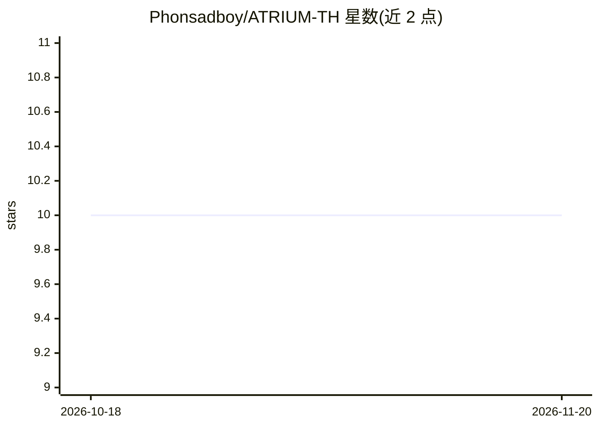

# Phonsadboy/ATRIUM-TH

⭐ 10 · Python · 推送 2026-06-10 · [GitHub](https://github.com/Phonsadboy/ATRIUM-TH) · 个人维护

**Mac/Windows 本地运行的多智能体 AI 公司工作台**

ATRIUM 是一个 local-first 的全栈工作区，用户与 Executive agent 对话后把任务分派到 research、engineering、content、operations 等部门，每个部门具备角色、工具、记忆、任务、artifacts 与可查看的 runtime 状态。仓库内含 FastAPI 后端、Vite 前端、Postgres/pgvector、Ollama、provider 认证、日志、健康检查与 CLI 命令；支持 Claude Code/ChatGPT 账号 OAuth、OpenAI/Anthropic API key 与本地 embeddings。安装路径为 Codex/Claude 辅助安装或 macOS/Windows 原生脚本，运行时访问 127.0.0.1:5173。

## 筛选速览

| 维度 | 判定 | 备注 |
|---|---|---|
| AI 角色 | `ai-native` | 本体是模型或模型工具 |
| 许可风险 | `none` | — |
| 部署形态 | `desktop` | 安装包/桌面程序 |
| 模型依赖 | local-ok | 支持本地模型 |
| 硬件要求 | — | 无带数字的原话,不猜 |
| 安装摩擦 | `low` | 无编译、无系统依赖或容器化 |
| 成熟度 | — | 结构信号不足 |

## 能力要点

- 一套仓库包含 UI、后端、数据库、provider 认证、记忆与健康检查
- Executive 分派任务到多部门的多智能体结构，各部门有独立记忆与 artifacts
- 通过 /api/runtime、provider status、日志与脱敏 report 验证运行状态
- Thai-first 引导流程，支持 Codex/Claude 辅助一键安装

## 适用场景

- 在个人电脑上搭建多部门协作的 AI 工作区
- 让 research/engineering/content 等部门 agent 接手分派的任务
- 本地使用 Ollama embeddings 而不全依赖云 API

## 场景标签

`多智能体` · 领域:Agent 开发

## 证据(README 行号)

> L17: ATRIUM คือ workspace สำหรับสร้าง "บริษัท AI ส่วนตัว" บนเครื่องของคุณ ผู้ใช้คุยกับ Executive แล้วระบบช่วยแตกงานไปยัง
> L140: ATRIUM is a local workspace for running a personal AI company on your Mac or Windows machine. You work with an Exe
> L148: - FastAPI backend, Vite frontend, Postgres/pgvector, Ollama, and runtime checks

## 星数曲线

2026-10-18 10 → 2026-11-20 10（+0）

---
*卡片 v1 · prompt 1.4 · 生成 2026-11-20 · 置信度 mid · 依据 README sha `f27660f52a93` · [字段定义](../../DATASET.md)*
