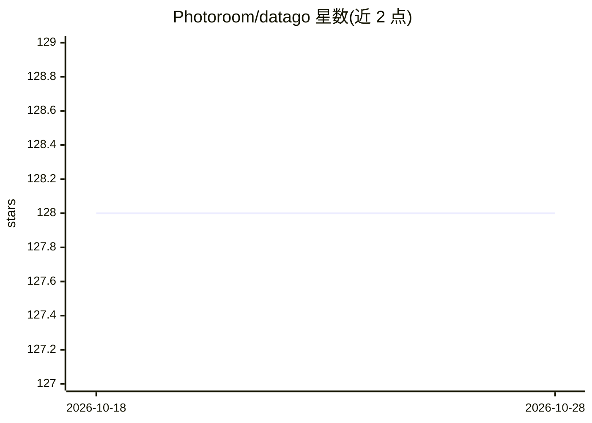

# Photoroom/datago

⭐ 128 · Rust · MIT · 推送 2026-10-27 · [GitHub](https://github.com/Photoroom/datago) · 组织维护

**面向图像 ML 的 Rust 并行数据加载器，Python 模块形式**

用 Rust 编写、以 Python 模块分发的数据加载器，在 Python GIL 之外处理逐样本 IO、jpg/png 解码、图像对齐等可选视觉处理与预编码，典型吞吐达 GB/s。数据源覆盖本地文件、webdataset（实验性）及 Dataroom 等 HTTP 栈，样本以 PIL/Numpy 原生类型交付，可提供 torch 兼容的 IterableDataset，并支持 rank/world-size 感知的样本分发。适合训练扩散模型、图像编码器等需要高速读取图像的工作负载。

## 筛选速览

| 维度 | 判定 | 备注 |
|---|---|---|
| AI 角色 | `ai-ecosystem` | LLM/agent 周边工具 |
| 许可风险 | `permissive` | MIT |
| 部署形态 | `library` | 以包/库形式分发 |
| 模型依赖 | — | README 未给出锁定关系 |
| 硬件要求 | — | 无带数字的原话,不猜 |
| 安装摩擦 | `low` | 无编译、无系统依赖或容器化 |
| 成熟度 | `idea` | |

## 能力要点

- Rust 实现，GIL 之外的并行逐样本 IO 与 jpg/png 解码，典型 GB/s 吞吐
- 在线图像处理：aspect ratio bucket 裁剪、resize、预编码（jpg/png），单 Python 进程可占满全部 CPU 核
- 支持本地文件、webdataset（实验性）、Dataroom HTTP 栈等数据源
- 提供 torch 兼容的 IterableDataset 封装与 rank/world-size 感知分发

## 适用场景

- 训练图像生成/编码模型时高速加载并预处理大批量图像
- 把 webdataset 或本地文件流转为 Python 原生图像对象供训练消费
- 单进程内用满多核做裁剪/resize 等预处理流水线

## 场景标签

`MLOps` · 领域:训练与推理

## 证据(README 行号)

> L6: A Rust-written data loader which can be used as a python module. Handles several data sources, from local files to w
> L15: Samples are exposed in the Python scope as python native objects, using PIL and Numpy base types. Speed will be net
> L106: ## Process images on the fly

## 星数曲线

2026-10-18 128 → 2026-10-28 128（+0）

---
*卡片 v1 · prompt 1.4 · 生成 2026-10-22 · 置信度 high · 依据 README sha `ab2108a29eb5` · [字段定义](../../DATASET.md)*
