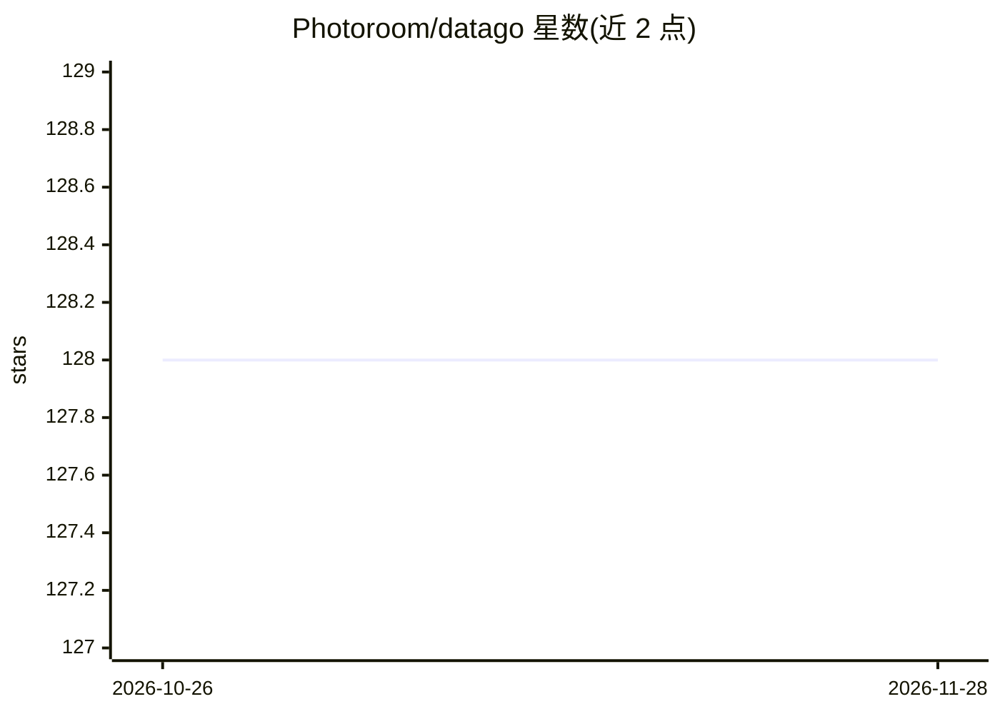

# Photoroom/datago

⭐ 128 · Rust · MIT · 推送 2026-11-24 · [GitHub](https://github.com/Photoroom/datago) · 组织维护

**为 Python 图像 ML 训练提供 GB/s 并行数据加载的 Rust 库**

用 Rust 编写、以 Python 模块形式使用的并行 dataloader，在 Python GIL 之外完成逐样本 IO、jpg/png 反序列化、可选的图像对齐处理与序列化。支持本地文件、HTTP、WebDataset 及向量数据库型 HTTP 数据源（dataroom），提供有界缓冲、取消机制与基于 rank/world-size 的分布式加载。图像可输出为 PIL 对象或共享 Rust 存储的只读 NumPy 视图，覆盖 aspect ratio bucketing、裁剪与缩放，返回 torch 兼容的 IterableDataset。通过 pip 安装。

## 筛选速览

| 维度 | 判定 | 备注 |
|---|---|---|
| AI 角色 | `ai-ecosystem` | LLM/agent 周边工具 |
| 许可风险 | `permissive` | MIT |
| 部署形态 | `library` | 以包/库形式分发 |
| 模型依赖 | — | README 未给出锁定关系 |
| 硬件要求 | — | 无带数字的原话,不猜 |
| 安装摩擦 | `low` | 无编译、无系统依赖或容器化 |
| 成熟度 | — | 结构信号不足 |

## 能力要点

- Rust 实现的逐样本 IO 与图像解码在 GIL 之外运行
- 输出 PIL 图像或共享 Rust 存储的只读 NumPy 视图
- 支持本地文件、HTTP、WebDataset、dataroom 数据源
- 支持分布式 rank/world-size 加载、有界缓冲与显式取消

## 适用场景

- 为图像生成/检测等 ML 训练管线高速供给样本
- 以 torch IterableDataset 接入 PyTorch 训练循环
- 多 rank 分布式读取大规模本地或 WebDataset 图像数据

## 场景标签

 · 领域:机器学习基础设施/数据加载

## 证据(README 行号)

> L6: A Rust-written data loader which can be used as a python module. Handles several data sources, from local files to w
> L23: You can simply install datago with `[uv] pip install datago`
> L26: Please note that in all the of the following cases, you can directly get an IterableDataset (torch compatible) with

## 星数曲线

2026-10-26 128 → 2026-11-28 128（+0）

---
*卡片 v1 · prompt 1.4 · 生成 2026-11-28 · 置信度 high · 依据 README sha `1e9c60c2c4fb` · [字段定义](../../DATASET.md)*
