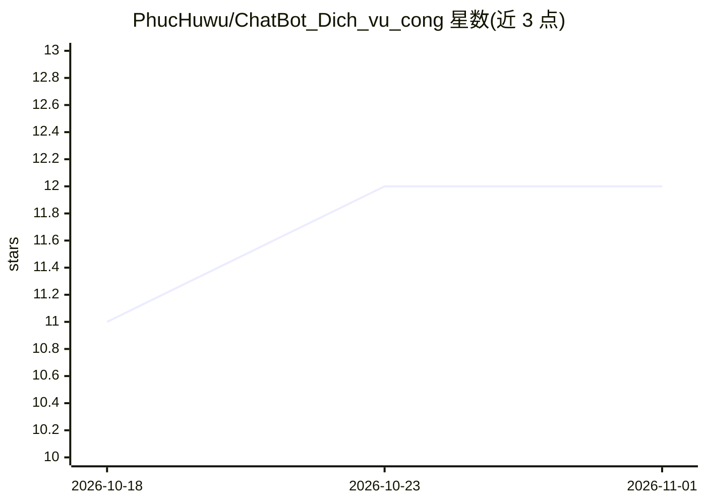

# PhucHuwu/ChatBot_Dich_vu_cong

⭐ 12 · Python · MIT · 推送 2025-12-09 · [GitHub](https://github.com/PhucHuwu/ChatBot_Dich_vu_cong) · [官网](https://chatbot-dichvucong.vercel.app/) · 个人维护

**越南公共服务 RAG 问答聊天机器人系统**

面向越南公共行政服务的 RAG 聊天系统：用户提问经多语言嵌入模型（paraphrase-multilingual-MiniLM-L12-v2）向量化后，由 FAISS 语义检索与 BM25 关键词检索经 RRF 融合，再用 CrossEncoder（ms-marco-MiniLM-L-6-v2）重排，生成环节调用 Groq API（默认 openai/gpt-oss-120b），以 SSE 流式返回带来源引用的回答。后端为 FastAPI，提供 Web 界面与 REST API，支持 Docker Compose 部署、LRU 缓存、速率限制与热更新索引；需自备 Groq API key，数据 JSON 文件不入库需本地准备。

## 筛选速览

| 维度 | 判定 | 备注 |
|---|---|---|
| AI 角色 | `ai-native` | 本体是模型或模型工具 |
| 许可风险 | `permissive` | MIT |
| 部署形态 | `self-host` | docker 或自建部署 |
| 模型依赖 | locked-api |  |
| 硬件要求 | — | 无带数字的原话,不猜 |
| 安装摩擦 | `low` | 无编译、无系统依赖或容器化 |
| 成熟度 | — | 结构信号不足 |

## 能力要点

- FAISS+BM25 混合检索（RRF 融合）+ CrossEncoder 重排
- SSE 流式回答并附来源引用
- Groq LLM API（默认 openai/gpt-oss-120b）+ 多语言嵌入
- FastAPI 后端，Docker/Docker Compose 部署，含健康检查与缓存管理 API

## 适用场景

- 搭建面向政务办事指南与 FAQ 的越南语问答服务
- 为公民提供带来源引用的公共流程咨询
- 作为 RAG 参考实现学习混合检索与重排管线

## 场景标签

`聊天机器人` `RAG` · 领域:对话与助手

## 证据(README 行号)

> L8: A production-ready RAG (Retrieval-Augmented Generation) chatbot system designed specifically for Vietnamese public a
> L47: 1. **Query Processing**: User query → Embedding generation → Vector normalization
> L73: - **Groq**: High-performance LLM API

## 星数曲线

2026-10-18 11 → 2026-11-01 12（+1）

---
*卡片 v1 · prompt 1.4 · 生成 2026-11-01 · 置信度 mid · 依据 README sha `86bbc5212197` · [字段定义](../../DATASET.md)*
