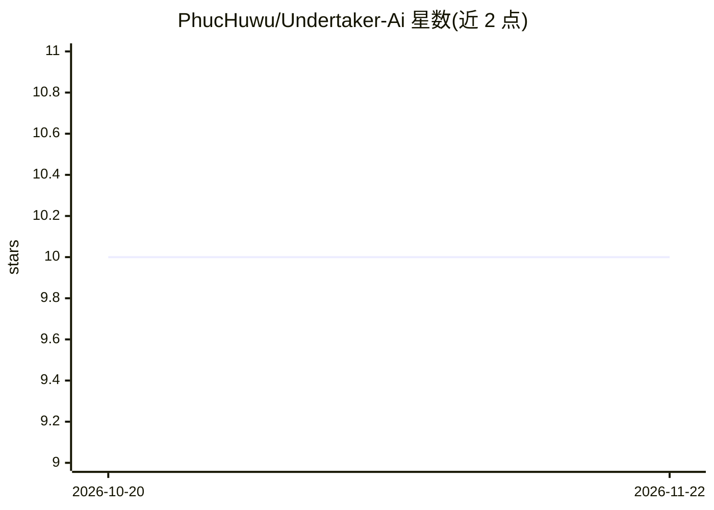

# PhucHuwu/Undertaker-Ai

⭐ 10 · Python · 推送 2026-01-22 · [GitHub](https://github.com/PhucHuwu/Undertaker-Ai) · 个人维护

**面向《86-不存在的战区》小说的 GraphRAG 问答界面**

基于 Streamlit 构建的 Web 应用，接入 Microsoft GraphRAG 知识索引，对《86 - Eighty Six》小说文本做问答推理。提供 Global（map-reduce 汇总社区摘要）与 Local（实体邻域遍历）两种检索模式，用 PyVis 渲染可交互知识图谱（边权重过滤、节点数限制、力导向布局），每条回答附带上下文文本块与社区报告以便溯源。依赖 Python 3.10+ 与 OpenAI 兼容 API key，索引构建需先运行 graphrag.index 流水线。

## 筛选速览

| 维度 | 判定 | 备注 |
|---|---|---|
| AI 角色 | `ai-native` | 本体是模型或模型工具 |
| 许可风险 | `none` | — |
| 部署形态 | `library` | 以包/库形式分发 |
| 模型依赖 | — | README 未给出锁定关系 |
| 硬件要求 | — | 无带数字的原话,不猜 |
| 安装摩擦 | `low` | 无编译、无系统依赖或容器化 |
| 成熟度 | — | 结构信号不足 |

## 能力要点

- Global（map-reduce）与 Local（实体邻域）两种查询模式
- PyVis 交互式知识图谱：边权重过滤、节点数限制、力导向布局
- 回答附带上下文文本块与社区报告，可对照原文核验
- lancedb 向量存储与本地缓存降低重复运行成本

## 适用场景

- 对小说剧情、人物、组织做结构化问答
- 可视化查看角色与事件的关系图谱
- 验证 AI 回答所引用的原文片段

## 场景标签

`知识图谱` `文档问答` · 领域:知识与检索

## 证据(README 行号)

> L3: **Undertaker-Ai** is a sophisticated interface designed to interact with a **Microsoft GraphRAG** knowledge index. T
> L115: - **Chat Interface**: Select "Global" or "Local" search, type your query, and view the AI-generated response along

## 星数曲线

2026-10-20 10 → 2026-11-22 10（+0）

---
*卡片 v1 · prompt 1.4 · 生成 2026-11-20 · 置信度 high · 依据 README sha `f2cd6e3b4965` · [字段定义](../../DATASET.md)*
