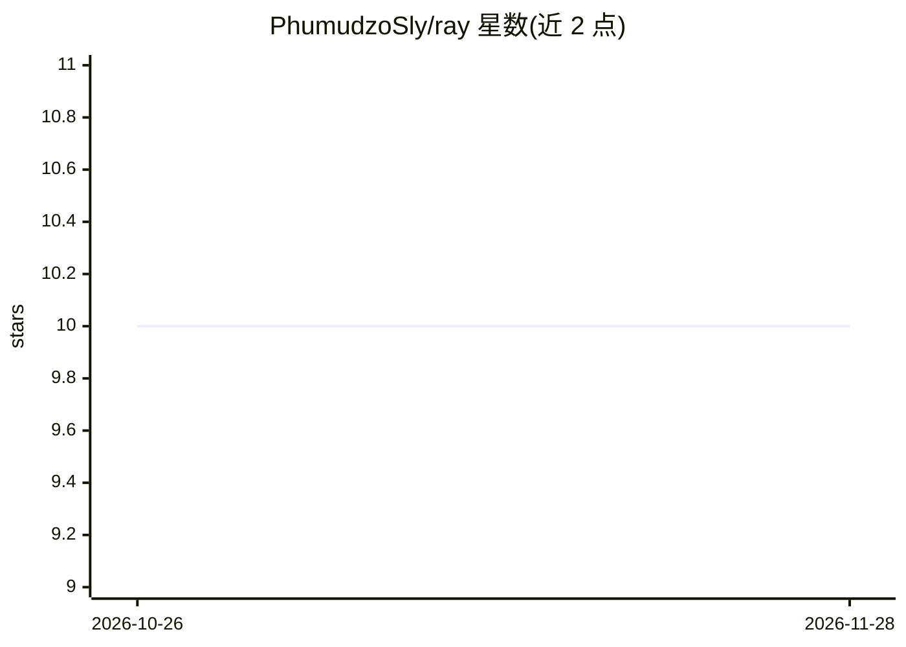

# PhumudzoSly/ray

⭐ 10 · TypeScript · MIT · 推送 2025-12-08 · [GitHub](https://github.com/PhumudzoSly/ray) · [官网](https://rayai.dev) · 个人维护

**面向创业者与产品团队的想法验证与产品开发平台**

一个开源 monorepo，包含主 web 应用、文档站与 landing 页三个 Next.js 应用，使用 TurboRepo、pnpm 与自定义 UI 包组织。平台将项目管理与 AI 驱动的市场调研、想法验证工具结合，供创业者与产品团队验证想法、做市场调研并构建产品。工具链包括 Biome、Husky、TypeScript，后端使用 Postgres 与 Prisma。README 未详细列出 AI 功能的具体模型或接口。

## 筛选速览

| 维度 | 判定 | 备注 |
|---|---|---|
| AI 角色 | `ai-enhanced` | 去掉 AI 部分产品仍成立 |
| 许可风险 | `permissive` | MIT |
| 部署形态 | `library` | 以包/库形式分发 |
| 模型依赖 | — | README 未给出锁定关系 |
| 硬件要求 | — | 无带数字的原话,不猜 |
| 安装摩擦 | `low` | 无编译、无系统依赖或容器化 |
| 成熟度 | — | 结构信号不足 |

## 能力要点

- web/docs/landing 三应用的 monorepo 结构
- pnpm + TurboRepo 构建与开发工作流
- Postgres 与 Prisma 作为后端服务

## 适用场景

- 验证 SaaS 产品想法并做市场调研
- 管理产品开发项目
- 快速启动包含文档站与 landing 页的应用工程

## 场景标签

 · 领域:产品开发/商业工具

## 证据(README 行号)

> L7: Ray is an open-source SaaS idea validation and product development platform that combines project management with AI
> L25: - **Postgres and Prisma**: Backend as a service

## 星数曲线

2026-10-26 10 → 2026-11-28 10（+0）

---
*卡片 v1 · prompt 1.4 · 生成 2026-11-20 · 置信度 mid · 依据 README sha `e150326ecaa8` · [字段定义](../../DATASET.md)*
