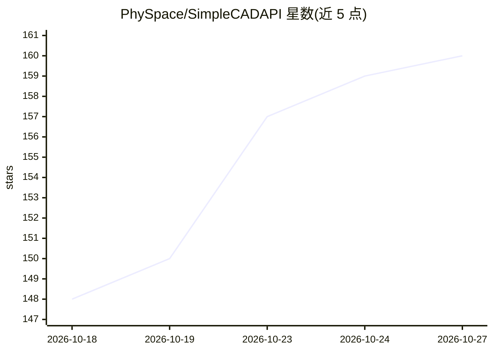

# PhySpace/SimpleCADAPI

⭐ 160 · Python · Apache-2.0 · 推送 2026-10-26 · [GitHub](https://github.com/PhySpace/SimpleCADAPI) · [官网](physpace.dev) · 组织维护 · 中文 README

**面向编码 agent 的参数化 CAD Python SDK：用代码构建可编辑 3D 模型**

基于 OpenCascade（OCP）的 Python SDK，为编码 agent 设计：模型是 marimo notebook 形式的纯 .py 文件，每特征一个 cell，尺寸为命名参数，选择通过 scad.ql 按几何属性完成，各步骤回传成败原因。支持单零件建模、含运动学约束的装配体、代码优先网页编辑器（sca edit）与仿真插件（STEP→Gmsh/CalculiX 做 FEM、MJCF→MuJoCo 做动力学）。可导出 STEP AP242/STL/可编辑 FreeCAD 工程与 .scadpkg 包，并附装到 agent 框架的技能安装命令（sca skill）。当前版本 2.2.6.post2，README 提示生产使用前需验证生成结果。

## 筛选速览

| 维度 | 判定 | 备注 |
|---|---|---|
| AI 角色 | `ai-ecosystem` | LLM/agent 周边工具 |
| 许可风险 | `permissive` | Apache-2.0 |
| 部署形态 | `library` | 以包/库形式分发 |
| 模型依赖 | — | README 未给出锁定关系 |
| 硬件要求 | — | 无带数字的原话,不猜 |
| 安装摩擦 | `low` | 无编译、无系统依赖或容器化 |
| 成熟度 | — | 结构信号不足 |

## 能力要点

- 模型即 marimo notebook 纯 .py 文件，每 cell 一特征，带 per-cell 缓存
- scad.ql 选择语言与语义标签，参数化重定义后选择保持稳定
- sca edit 代码优先编辑器：视口点选自动写回选择 cell 供 agent 读取
- 仿真插件链路：AP242→Gmsh/CalculiX 静力 FEM、MJCF→MuJoCo 机构动力学

## 适用场景

- 让 Claude Code/Codex 等编码 agent 按自然语言构建参数化零件与装配体
- 在代码优先编辑器中与 agent 协作迭代 CAD 模型并导出 STEP/STL
- 把参数化模型送入 Gmsh/CalculiX 做 FEM 或 MuJoCo 做机构动力学仿真

## 场景标签

 · 领域:CAD/工程建模

## 证据(README 行号)

> L7: **Start here.** Paste this line to your coding agent (Claude Code, Codex, OpenCode, …):
> L15: parametric CAD SDK built for agents: a model is a notebook of code, every
> L138: SimpleCADAPI is an OCP-native Python SDK for building CAD models with clear,

## 星数曲线

2026-10-18 148 → 2026-10-27 160（+12）

---
*卡片 v1 · prompt 1.4 · 生成 2026-10-23 · 置信度 high · 依据 README sha `5fabf5bf4705` · [字段定义](../../DATASET.md)*
