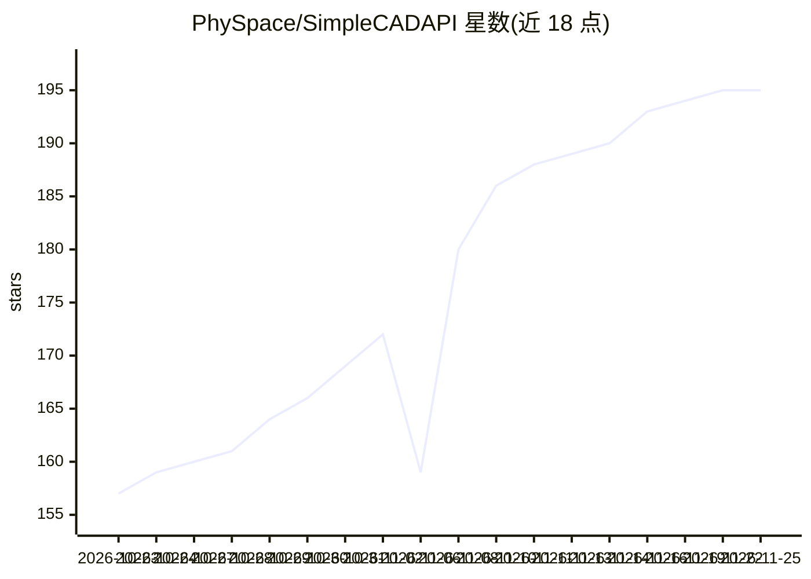

# PhySpace/SimpleCADAPI

⭐ 195 · Python · Apache-2.0 · 推送 2026-11-23 · [GitHub](https://github.com/PhySpace/SimpleCADAPI) · [官网](physpace.dev) · 组织维护 · 中文 README

**面向语言模型 agent 的参数化 CAD SDK，生成可编辑 3D 模型**

为编码 agent 设计的参数化 CAD SDK：几何引擎为 wheel 内置的 OpenCASCADE C++ 实现，一次 pip install 即可用，不依赖 CadQuery/OCP 栈。API 无隐藏状态，每步可缓存、校验与重放；错误信息含测量数值与修复建议，几何按稳定 ref 选择。附 `sca edit` 代码优先编辑器与分路由的 agent skill（七条工作流），并支持插件仓库扩展检测、仿真与格式转换。提供 STEP 重建、扫描重建、工程图纸导出等路线。

## 筛选速览

| 维度 | 判定 | 备注 |
|---|---|---|
| AI 角色 | `ai-native` | 本体是模型或模型工具 |
| 许可风险 | `permissive` | Apache-2.0 |
| 部署形态 | `library` | 以包/库形式分发 |
| 模型依赖 | — | README 未给出锁定关系 |
| 硬件要求 | — | 无带数字的原话,不猜 |
| 安装摩擦 | `low` | 无编译、无系统依赖或容器化 |
| 成熟度 | — | 结构信号不足 |

## 能力要点

- 一次 pip install，OpenCASCADE 几何引擎内置于 wheel
- 按 cell 缓存与重放的函数式 API，参数变更只重算依赖 cell
- agent skill：七条工作流路由，首批读取 ≤1,200 行
- 插件机制：连接件校验、FEM 网格准备以插件形式提供

## 适用场景

- 让编码 agent 直接生成参数化 3D 零件与装配体
- 从 STEP 文件、网格或点云重建可编辑模型
- 导出 STEP AP242/STL/DXF 用于生产或交付
- 准备 FEM 网格并驱动 CalculiX/MuJoCo 仿真

## 场景标签

`代码生成` · 领域:编码与开发

## 证据(README 行号)

> L5:  Parametric CAD built for agents. Efficient · Low-overhead · Agent-native
> L25: |**Low-overhead**|One `pip install`: the geometry engine is native C++ on OpenCASCADE inside the wheel, with no Cad
> L19: CAD software was made for a person with a mouse. An agent has no mouse. It has code, a context window and a token b

## 星数曲线

2026-10-23 157 → 2026-11-25 195（+38）

---
*卡片 v1 · prompt 1.4 · 生成 2026-11-25 · 置信度 high · 依据 README sha `38be5c29aa95` · [字段定义](../../DATASET.md)*
