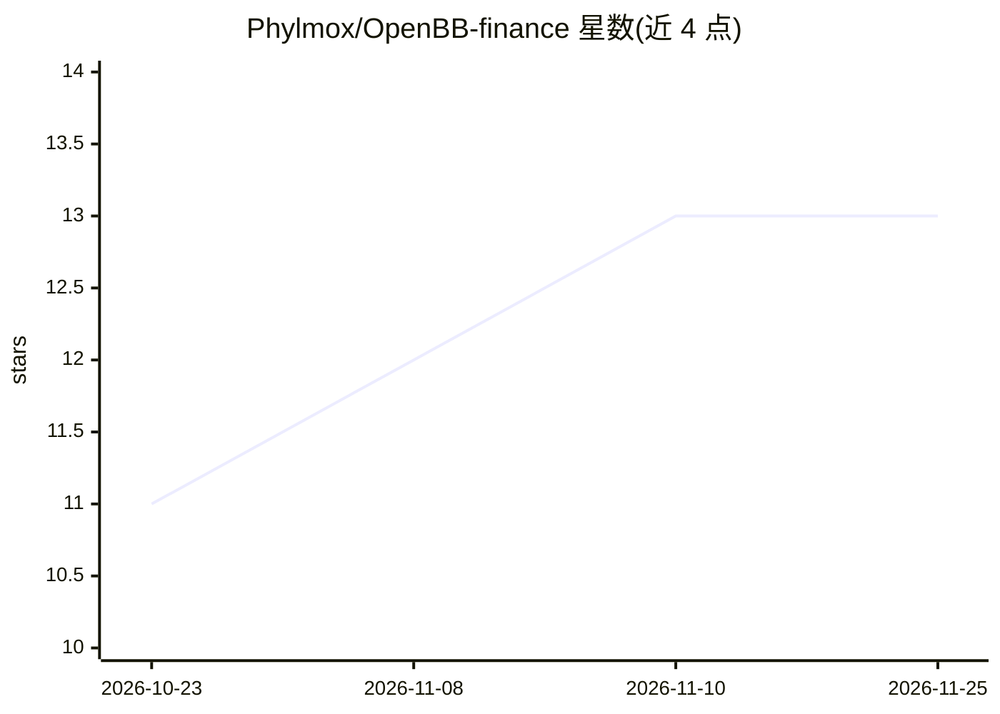

# Phylmox/OpenBB-finance

⭐ 13 · Python · MIT · 推送 2026-08-23 · [GitHub](https://github.com/Phylmox/OpenBB-finance) · 组织维护

**开源金融数据平台：统一接入多类市场数据**

开源金融数据平台，通过 Python 接口或 CLI 提供对股票、期权、加密货币、外汇、宏观经济、固定收益等数据的访问，并支持按需扩展插件。数据接入以数十家数据供应商的集成为核心，输出可转为 DataFrame 使用。可启动本地 FastAPI 服务（openbb-api，127.0.0.1:6900）连接 OpenBB Workspace 企业界面；Workspace 上可使用 AI agents 属于可选功能，平台本体为数据集成库。AGPLv3 许可，提供 PyPI 安装与源码克隆两种途径。

## 筛选速览

| 维度 | 判定 | 备注 |
|---|---|---|
| AI 角色 | `ai-enhanced` | 去掉 AI 部分产品仍成立 |
| 许可风险 | `permissive` | MIT |
| 部署形态 | `library` | 以包/库形式分发 |
| 模型依赖 | — | README 未给出锁定关系 |
| 硬件要求 | — | 无带数字的原话,不猜 |
| 安装摩擦 | `low` | 无编译、无系统依赖或容器化 |
| 成熟度 | — | 结构信号不足 |

## 能力要点

- 统一 Python 接口访问股票、期权、加密、外汇、宏观、固收等数据
- 提供 CLI（pip install openbb-cli）访问平台
- openbb-api 命令启动 FastAPI/Uvicorn 本地服务（127.0.0.1:6900）
- 提供 PyPI 包与 git clone 源码两种安装方式

## 适用场景

- 用 Python 拉取多资产类别的历史行情数据做研究分析
- 将本地 OpenBB 后端接入 OpenBB Workspace 可视化
- 按需安装扩展补充自己需要的数据源

## 场景标签

`金融量化` · 领域:学习与行业

## 证据(README 行号)

> L17: The OpenBB Platform offers access to equity, options, crypto, forex, macro economy, fixed income, and more while al
> L35: If you want an enterprise UI to visualize this datasets and use AI agents on top, you can find OpenBB Workspace at 

## 星数曲线

2026-10-23 11 → 2026-11-25 13（+2）

---
*卡片 v1 · prompt 1.4 · 生成 2026-11-18 · 置信度 high · 依据 README sha `1438593597f2` · [字段定义](../../DATASET.md)*
