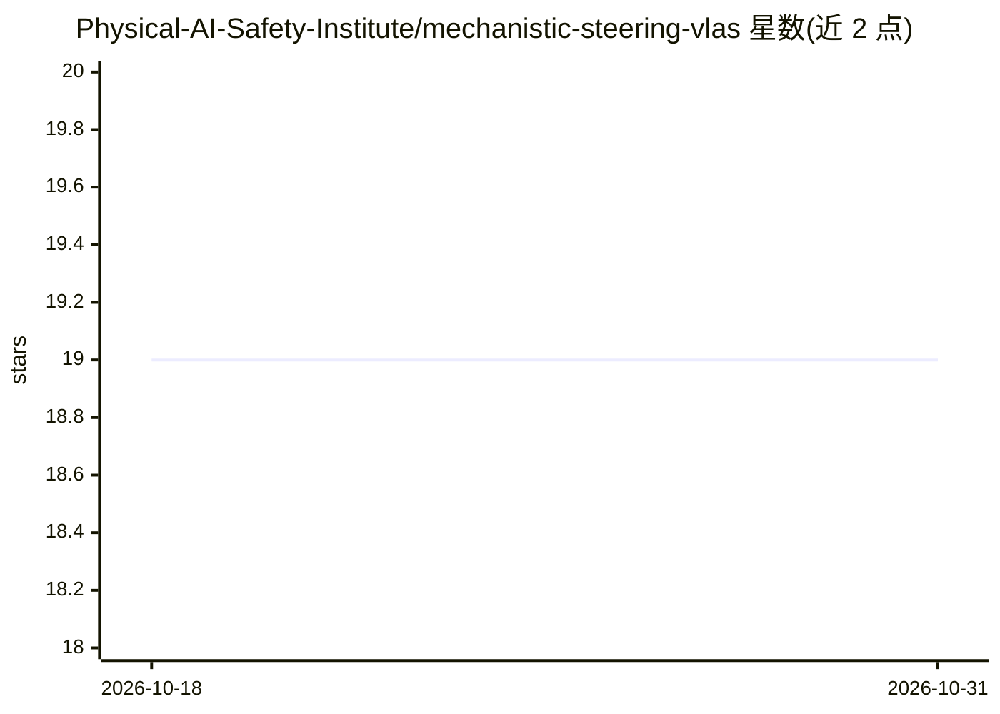

# Physical-AI-Safety-Institute/mechanistic-steering-vlas

⭐ 19 · Python · 推送 2026-01-30 · [GitHub](https://github.com/Physical-AI-Safety-Institute/mechanistic-steering-vlas) · [官网](https://vla-mech-interp.github.io) · 组织维护

**VLA 机器人策略的机制可解释性与激活层转向研究工具**

CoRL 2025 论文配套代码库：将 VLA 模型 FFN 值向量投影到词汇空间以识别因果语义机制（如 slow/up/careful），并在推理时注入概念对齐向量以实时改变机器人行为，无需微调、奖励信号或环境交互。提供 OpenVLA（LIBERO 评测）与 π₀/π₀-FAST（LeRobot 评测）两套流水线：值向量提取、聚类注册干预、仿真评测生成成功率 CSV 与轨迹对比图。通过 conda 环境文件安装，OpenPI 路径支持 JAX CPU 回退。

## 筛选速览

| 维度 | 判定 | 备注 |
|---|---|---|
| AI 角色 | `ai-ecosystem` | LLM/agent 周边工具 |
| 许可风险 | `none` | — |
| 部署形态 | `None` |  |
| 模型依赖 | — | README 未给出锁定关系 |
| 硬件要求 | — | 无带数字的原话,不猜 |
| 安装摩擦 | `low` | 无编译、无系统依赖或容器化 |
| 成熟度 | — | 结构信号不足 |

## 能力要点

- FFN 值向量→token 投影，提取可语义检查的机制方向
- 推理时激活转向控制机器人行为，无需微调
- 覆盖 OpenVLA/LIBERO 与 π₀/π₀-FAST 两套模型与仿真环境
- 实验产出成功率 CSV、动作日志与基线-干预轨迹对比图

## 适用场景

- 研究 VLA 模型内部语义机制与行为的因果关系
- 在仿真中实时干预机器人策略行为并量化效果
- 复现或扩展 CoRL 2025 论文实验

## 场景标签

`科研工具` · 领域:学习与行业

## 证据(README 行号)

> L20: We introduce an activation‑level interface for controlling Vision‑Language‑Action (VLA) policies without fine‑tunin
> L22: This repository provides:
> L26: ## VLA Steering Pipelines

## 星数曲线

2026-10-18 19 → 2026-10-31 19（+0）

---
*卡片 v1 · prompt 1.4 · 生成 2026-10-28 · 置信度 high · 依据 README sha `592e543fdfdc` · [字段定义](../../DATASET.md)*
