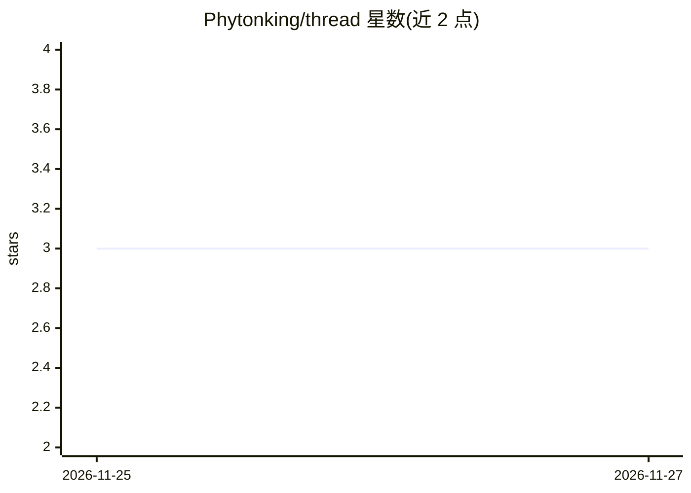

# Phytonking/thread

⭐ 3 · Rust · MIT · 推送 2026-11-16 · [GitHub](https://github.com/Phytonking/thread) · 个人维护

**单终端并行编排多个编程 agent 的 Rust 轻量 harness**

一个约 5 MB 的 Rust 单二进制 agent harness，内置 SQLite，无服务器无守护进程。用户与主 agent 对话，由其派生并行后台线程：每个线程拥有独立会话、独立 git worktree 与分支、独立模型，并共享 repo 记忆。thread 以 headless 方式驱动 claude/codex/grok/fx 官方 CLI，复用用户已有订阅而非 API 计费，也支持 API key 与本地模型。每步保存到 SQLite 可恢复会话；线程默认锁定在启动目录，macOS 由系统沙箱强制。要求 macOS/Linux 与 Rust 工具链，从源码构建。

## 筛选速览

| 维度 | 判定 | 备注 |
|---|---|---|
| AI 角色 | `ai-ecosystem` | LLM/agent 周边工具 |
| 许可风险 | `permissive` | MIT |
| 部署形态 | `None` |  |
| 模型依赖 | local-ok | 支持本地模型 |
| 硬件要求 | — | 无带数字的原话,不猜 |
| 安装摩擦 | `medium` | 含编译或系统依赖之一 |
| 成熟度 | — | 结构信号不足 |

## 能力要点

- main agent 派生并行线程，每线程独立会话/git worktree/分支/模型
- headless 驱动 claude/codex/grok/fx 官方 CLI，复用已有订阅登录，不触碰其 token
- 所有步骤持久化到 SQLite，退出后可恢复会话
- 线程默认限定目录，macOS 系统沙箱强制约束（含 --yolo）

## 适用场景

- 让不同订阅的模型分工并行处理任务（如一个规划、一个修测试、本地模型写文档）
- 在多个分支上并行改动代码并随时审批/干预任一线程
- 希望用已有订阅而非 API 账单驱动编程 agent

## 场景标签

`编码 Agent` · 领域:编码与开发

## 证据(README 行号)

> L5: `thread` is a lightweight agent harness in Rust: one ~5 MB binary, SQLite bundled, no server, no daemon. You talk to
> L16: - **Your subscriptions, not API bills.** thread drives the official `claude`, `codex`, `grok` and `fx` CLIs headles
> L39: Requires macOS or Linux and a Rust toolchain.

## 星数曲线

2026-11-25 3 → 2026-11-27 3（+0）

---
*卡片 v1 · prompt 1.4 · 生成 2026-11-24 · 置信度 high · 依据 README sha `5a1fd0a5bd76` · [字段定义](../../DATASET.md)*
