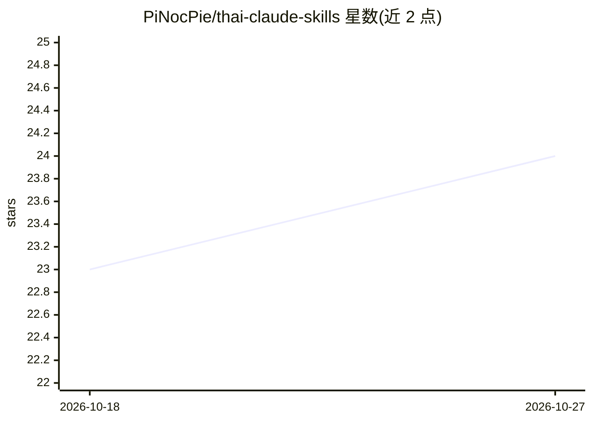

# PiNocPie/thai-claude-skills

⭐ 24 · Python · NOASSERTION · 推送 2026-08-05 · [GitHub](https://github.com/PiNocPie/thai-claude-skills) · 个人维护

**67 个泰语 Claude Skills 合集：面向泰国职场人士与学生**

将开源英文 Claude Skills 翻译为泰语并按职业/角色分类的技能合集：67 个 SKILL.md 格式文本技能，覆盖 Marketing、文案、HR、设计、生产力与学术写作等类别，另含 1 个本地运行的 reel-editor-th 短视频剪辑系统（需 macOS Apple Silicon + Claude Code + ffmpeg + python）。技能适配泰语触发词，保留原作者 attribution，来源与许可证记录于 CREDITS.md。使用方式为 Claude Code 插件市场安装、git clone 复制或直接粘贴至 Claude.ai。

## 筛选速览

| 维度 | 判定 | 备注 |
|---|---|---|
| AI 角色 | `ai-knowledge` | 知识聚合/清单类 |
| 许可风险 | `none` | NOASSERTION |
| 部署形态 | `None` |  |
| 模型依赖 | — | README 未给出锁定关系 |
| 硬件要求 | — | 无带数字的原话,不猜 |
| 安装摩擦 | `medium` | 含编译或系统依赖之一 |
| 成熟度 | — | 结构信号不足 |

## 能力要点

- 67 个泰语化 SKILL.md 技能，按职业/角色分类
- 适配泰语触发词，Claude 按指令自动调用
- 另含 reel-editor-th：本地运行、生成 9:16 Reel 并配泰语字幕
- 来源 repo 与各 skill 许可证在 CREDITS.md 记录

## 适用场景

- 泰国职场人士用泰语让 Claude 写 JD、做营销内容
- 学生用泰语完成学术写作与求职准备
- 内容创作者本地运行 AI 剪辑口播视频为 Reel

## 场景标签

`提示工程` `AI 写作` · 领域:Agent 开发

## 证据(README 行号)

> L3: **คลัง SKILL.md ภาษาไทย 67 ตัว สำหรับคนทำงาน + นักศึกษา**
> L7: ใช้กับ Claude.ai, Claude Code, Cursor, Codex, หรือ AI coding agent ตัวไหนก็ได้ที่รองรับ Agent Skills format
> L27: - ✅ แปลเป็นไทยทั้งหมด

## 星数曲线

2026-10-18 23 → 2026-10-27 24（+1）

---
*卡片 v1 · prompt 1.4 · 生成 2026-10-27 · 置信度 high · 依据 README sha `d6900281aa34` · [字段定义](../../DATASET.md)*
