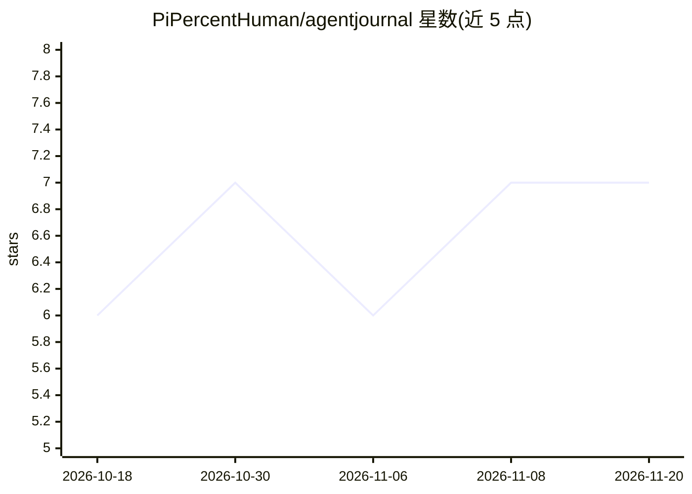

# PiPercentHuman/agentjournal

⭐ 7 · JavaScript · MIT · 推送 2026-11-07 · [GitHub](https://github.com/PiPercentHuman/agentjournal) · [官网](https://github.com/PiPercentHuman/agentjournal#readme) · 个人维护

**给编码 agent 的记忆层：钉住指令、记录行动日志、跨上下文续接**

面向长任务编码 agent 的记忆扩展：用户指令逐字钉存（PIN），每个动作用一行日志记录（JOURNAL），上下文将满或话题结束时折叠旧内容并从钉存与日志恢复（SLEEP）。0.3 版处理中途修改指令的场景：新指令全文写入对应钉存之下，唤醒时以子章节呈现。提供 pi 扩展、Claude Code 插件、Codex/Copilot 钩子，以及 `agentjournal` 命令行；基准测试在 Qwen3.5-9B 本地模型上与 compaction 对比。Claude Code 的 /clear 需用户手动输入，agent 只能请求。

## 筛选速览

| 维度 | 判定 | 备注 |
|---|---|---|
| AI 角色 | `ai-ecosystem` | LLM/agent 周边工具 |
| 许可风险 | `permissive` | MIT |
| 部署形态 | `library` | 以包/库形式分发 |
| 模型依赖 | — | README 未给出锁定关系 |
| 硬件要求 | — | 无带数字的原话,不猜 |
| 安装摩擦 | `low` | 无编译、无系统依赖或容器化 |
| 成熟度 | — | 结构信号不足 |

## 能力要点

- 指令逐字钉存，摘要式压缩不改动原文
- 每个动作一行日志，跨 /clear 与 compaction 续接任务状态
- pi 扩展、Claude Code 插件与 Codex/Copilot 钩子同包分发
- 0.3 版支持中途修改指令并以钉存子章节生效

## 适用场景

- 让 Claude Code 会话在 /clear 后从中断处继续
- 长任务中保持最初给定的格式规则与计数
- 多轮修改指令后确保 agent 执行最新版本

## 场景标签

`Agent 记忆` · 领域:Agent 开发

## 证据(README 行号)

> L11: A memory for coding agents on long jobs. Your instructions are kept word for word, every action gets one line in a
> L73: |**Claude Code**|you are asked first (Allow / Deny, with the topic line); on Allow the agent ends its turn and you 

## 星数曲线

2026-10-18 6 → 2026-11-20 7（+1）

---
*卡片 v1 · prompt 1.4 · 生成 2026-11-20 · 置信度 high · 依据 README sha `4d2be2e80a52` · [字段定义](../../DATASET.md)*
