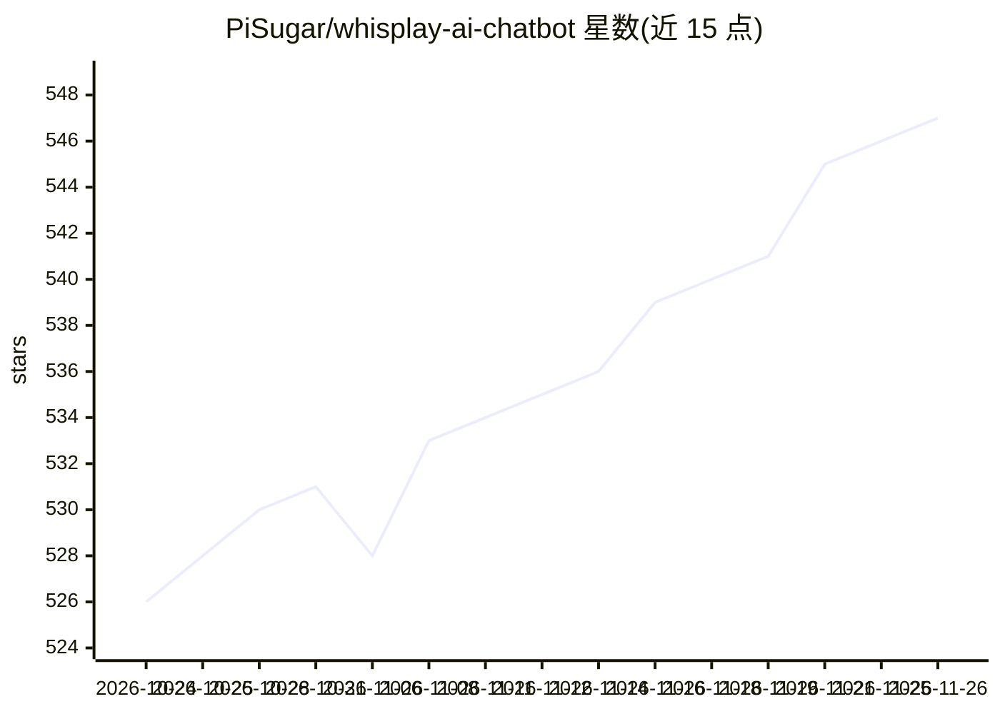

# PiSugar/whisplay-ai-chatbot

⭐ 547 · TypeScript · GPL-3.0 · 推送 2026-11-23 · [GitHub](https://github.com/PiSugar/whisplay-ai-chatbot) · 组织维护 · 中文 README

**基于树莓派 Zero 2w/5 的掌上语音 AI 聊天机器人**

运行在 Raspberry Pi Zero 2w / 5 与 PiSugar Whisplay HAT 上的掌上语音聊天设备：按键说话即可获得语音回复。链路覆盖语音识别（含 Zipformer 离线 ASR）、LLM 对话、TTS 播报，并提供唤醒词、自动聆听、实时字幕、文生图、摄像头预览与电量显示等功能。支持 LLM8850 与 Raspberry Pi AI HAT+ 2（Hailo-10H）加速卡运行 whisper、melotts、Qwen3 等模型。通过 git clone 源码安装依赖并构建，项目 wiki 另提供预构建镜像。

## 筛选速览

| 维度 | 判定 | 备注 |
|---|---|---|
| AI 角色 | `ai-native` | 本体是模型或模型工具 |
| 许可风险 | `viral` | GPL-3.0 |
| 部署形态 | `library` | 以包/库形式分发 |
| 模型依赖 | — | README 未给出锁定关系 |
| 硬件要求 | — | 无带数字的原话,不猜 |
| 安装摩擦 | `low` | 无编译、无系统依赖或容器化 |
| 成熟度 | — | 结构信号不足 |

## 能力要点

- 按键说话即获得语音回复，支持唤醒词与自动聆听
- Zipformer 离线 ASR 并显示实时字幕
- LLM8850 与 AI HAT+ 2（Hailo-10H）加速卡支持 whisper/TTS/Qwen3/图像生成
- 提供 Node.js 交互式配置向导 whisplay configure 与开机自启

## 适用场景

- 自制一台可对话的掌上 AI 语音玩具/对讲机
- 在离线环境下用树莓派搭建本地语音助手
- 给 PiSugar Whisplay HAT 硬件找配套聊天机器人软件

## 场景标签

`聊天机器人` `语音 Agent` `语音识别` `语音合成` · 领域:对话与助手

## 证据(README 行号)

> L7: This is a pocket-sized AI chatbot device built using a Raspberry Pi Zero 2w / 5. Just press the button, speak, and i
> L36: ## Hardware
> L197: - Support LLM8850 whisper ✅

## 星数曲线

2026-10-24 526 → 2026-11-26 547（+21）

---
*卡片 v1 · prompt 1.4 · 生成 2026-11-25 · 置信度 mid · 依据 README sha `cda0a15603f4` · [字段定义](../../DATASET.md)*
