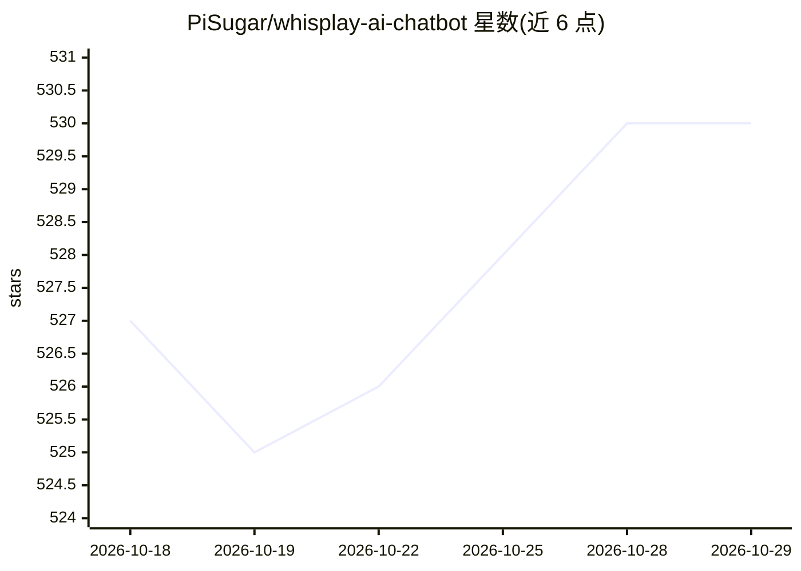

# PiSugar/whisplay-ai-chatbot

⭐ 530 · TypeScript · GPL-3.0 · 推送 2026-10-22 · [GitHub](https://github.com/PiSugar/whisplay-ai-chatbot) · 组织维护 · 中文 README

**树莓派口袋 AI 语音聊天机器人（按键说话、语音应答）**

基于 Raspberry Pi Zero 2w / 5 与 PiSugar Whisplay HAT（含 LCD、扬声器、麦克风）的便携 AI 聊天设备：按键说话，通过 ASR、LLM、TTS 生成语音应答，形态类似对讲机。提供预构建镜像（wiki 获取）、git clone 加脚本安装方式，支持 wake word 唤醒、文字生图、电池电量显示；可选离线方案使用 LLM8850 或 Raspberry Pi AI HAT+ 2（Hailo-10H）加速卡运行 whisper、Qwen3、TTS 与图像生成。外壳 3D 打印文件可选。GPL-3.0 许可。

## 筛选速览

| 维度 | 判定 | 备注 |
|---|---|---|
| AI 角色 | `ai-native` | 本体是模型或模型工具 |
| 许可风险 | `viral` | GPL-3.0 |
| 部署形态 | `library` | 以包/库形式分发 |
| 模型依赖 | — | README 未给出锁定关系 |
| 硬件要求 | — | 无带数字的原话,不猜 |
| 安装摩擦 | `low` | 无编译、无系统依赖或容器化 |
| 成熟度 | — | 结构信号不足 |

## 能力要点

- 按键语音交互：ASR + LLM + TTS 生成语音应答
- 支持 LLM8850 / Hailo-10H 加速卡的离线构建（whisper、Qwen3、TTS、生图）
- wake word 免手操作与电池电量显示
- 提供预构建镜像与 whisplay configure 交互式配置向导

## 适用场景

- 动手搭建一台随身携带的语音 AI 聊天硬件
- 用加速卡在树莓派上离线运行语音问答与生图
- 制作带屏幕和电池的桌面语音助手摆件

## 场景标签

`聊天机器人` `语音 Agent` `图像生成` · 领域:对话与助手

## 证据(README 行号)

> L7: This is a pocket-sized AI chatbot device built using a Raspberry Pi Zero 2w / 5. Just press the button, speak, and i
> L25: - Raspberry Pi zero 2w (Recommand RRi 5, 8G RAM for offline build)

## 星数曲线

2026-10-18 527 → 2026-10-29 530（+3）

---
*卡片 v1 · prompt 1.4 · 生成 2026-10-21 · 置信度 mid · 依据 README sha `618bdb4e93f7` · [字段定义](../../DATASET.md)*
