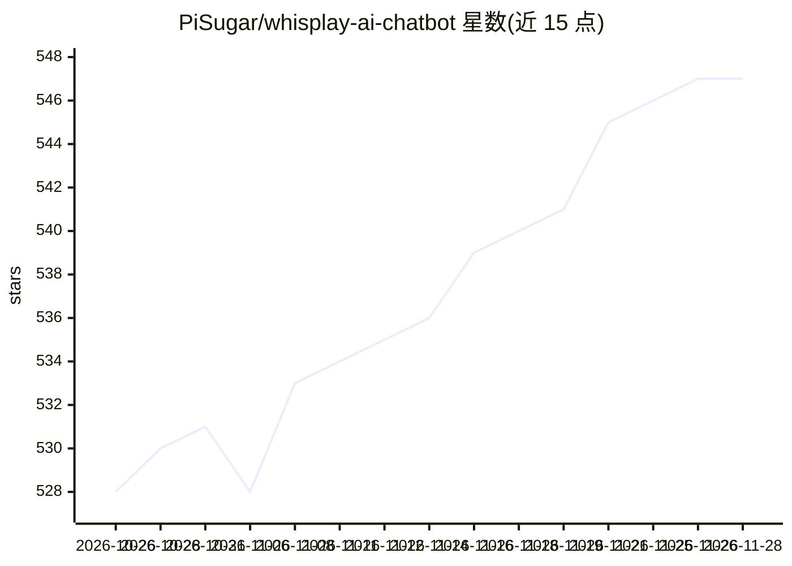

# PiSugar/whisplay-ai-chatbot

⭐ 547 · TypeScript · GPL-3.0 · 推送 2026-11-27 · [GitHub](https://github.com/PiSugar/whisplay-ai-chatbot) · 组织维护 · 中文 README

**基于树莓派 Zero 2W/5 的掌上语音 AI 聊天机器人**

运行于树莓派 Zero 2W/5 上的口袋尺寸 AI 聊天机器人设备，配合 PiSugar Whisplay HAT（LCD 屏幕、扬声器、麦克风）与电池使用。按住按钮说话即获语音回答，支持唤醒词、自动收听、结束关键词与实时字幕；语音链路含 ASR 与 TTS，另有文本生成图像、摄像头预览与电量显示功能。提供预构建镜像，也可自行安装驱动后从源码克隆、安装依赖并构建运行；离线构建推荐 8G RAM 的树莓派 5。

## 筛选速览

| 维度 | 判定 | 备注 |
|---|---|---|
| AI 角色 | `ai-native` | 本体是模型或模型工具 |
| 许可风险 | `viral` | GPL-3.0 |
| 部署形态 | `library` | 以包/库形式分发 |
| 模型依赖 | — | README 未给出锁定关系 |
| 硬件要求 | — | 无带数字的原话,不猜 |
| 安装摩擦 | `low` | 无编译、无系统依赖或容器化 |
| 成熟度 | — | 结构信号不足 |

## 能力要点

- 按键说话即对话，支持唤醒词与自动收听（含实时字幕）
- 语音链路覆盖 ASR 与 TTS，另有文生图与摄像头拍照功能
- 提供预构建镜像与交互式配置向导（whisplay configure）
- 支持 LLM8850 与 Raspberry Pi AI HAT+ (Hailo-10H) 加速卡

## 适用场景

- DIY 一台掌上语音聊天机器人
- 搭建离线本地运行的 ASR/LLM/TTS 语音设备
- 配合 3D 打印外壳做成便携 AI 对讲机

## 场景标签

`聊天机器人` `语音 Agent` `图像生成` · 领域:对话与助手

## 证据(README 行号)

> L7: This is a pocket-sized AI chatbot device built using a Raspberry Pi Zero 2w / 5. Just press the button, speak, and i
> L178: **Image Generation** for generating images from text prompts.
> L202: - Support LLM8850 whisper ✅

## 星数曲线

2026-10-26 528 → 2026-11-28 547（+19）

---
*卡片 v1 · prompt 1.4 · 生成 2026-11-28 · 置信度 mid · 依据 README sha `9d4c14e518c0` · [字段定义](../../DATASET.md)*
