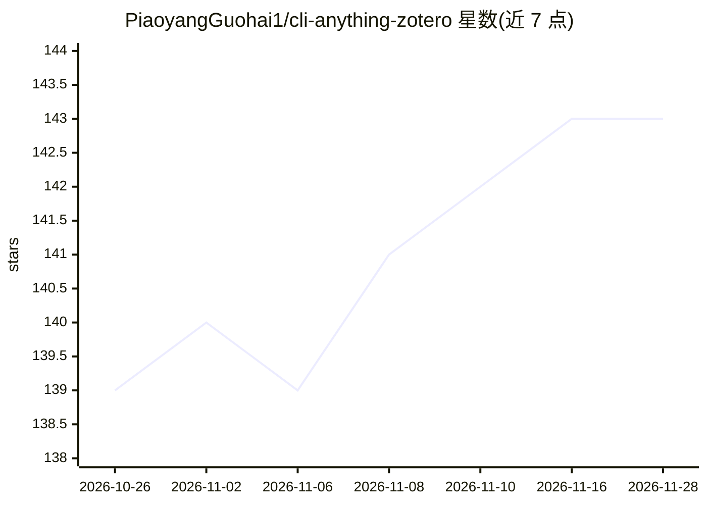

# PiaoyangGuohai1/cli-anything-zotero

⭐ 143 · Python · Apache-2.0 · 推送 2026-11-04 · [GitHub](https://github.com/PiaoyangGuohai1/cli-anything-zotero) · [官网](https://pypi.org/project/cli-anything-zotero/) · 个人维护 · 中文 README

**让 AI 助手通过 CLI 管理本地 Zotero 文献库的工具**

为 Zotero 7+ 提供的 CLI/SDK 工具，安装后由 Claude Code、Cursor 等 AI 客户端在终端调用 70+ 命令，完成检索、DOI/PMID/RIS 导入、BibTeX/CSL-JSON 导出、PDF 附加与全文检索、标签笔记管理、去重合并与软删除恢复等操作。通过 Zotero 桌面端内的 JS Bridge 插件以本地特权接口读写，写操作无需 API key 与联网。DOCX 引用插入的动态模式需额外安装 LibreOffice 及 Zotero LO 插件；MCP 接口自 v0.9.5 起冻结，不再新增功能。

## 筛选速览

| 维度 | 判定 | 备注 |
|---|---|---|
| AI 角色 | `ai-ecosystem` | LLM/agent 周边工具 |
| 许可风险 | `permissive` | Apache-2.0 |
| 部署形态 | `library` | 以包/库形式分发 |
| 模型依赖 | — | README 未给出锁定关系 |
| 硬件要求 | — | 无带数字的原话,不猜 |
| 安装摩擦 | `low` | 无编译、无系统依赖或容器化 |
| 成熟度 | — | 结构信号不足 |

## 能力要点

- 70+ CLI 命令覆盖 Zotero 检索、导入导出、PDF、笔记与写操作
- 经 Zotero 桌面端 JS Bridge 本地运行，写操作无需 API key 或联网
- DOCX 占位符转静态/可刷新引用，docx doctor 检查依赖链
- 去重合并基于 DOI 与规范化标题，保留回收站可恢复的删除语义

## 适用场景

- 用自然语言让 AI 在 Zotero 里检索和导入论文
- 批量导出文献集合为 BibTeX 用于论文写作
- 让 AI 查找并补齐文献条目缺失的 PDF
- 在 AI 撰写的 DOCX 草稿中插入 Zotero 引用

## 场景标签

`科研工具` · 领域:学习与行业

## 证据(README 行号)

> L9: **Let AI manage your Zotero library.**
> L34: Built on CLI-Anything by HKUDS, this tool gives AI agents full access to your local Zotero library through a **JS B
> L88: `cli-anything-zotero` is now maintained as a CLI/SDK-first tool. The primary interface is the `zotero-cli` shell co

## 星数曲线

2026-10-26 139 → 2026-11-28 143（+4）

---
*卡片 v1 · prompt 1.4 · 生成 2026-11-27 · 置信度 high · 依据 README sha `2301cc2cf14d` · [字段定义](../../DATASET.md)*
