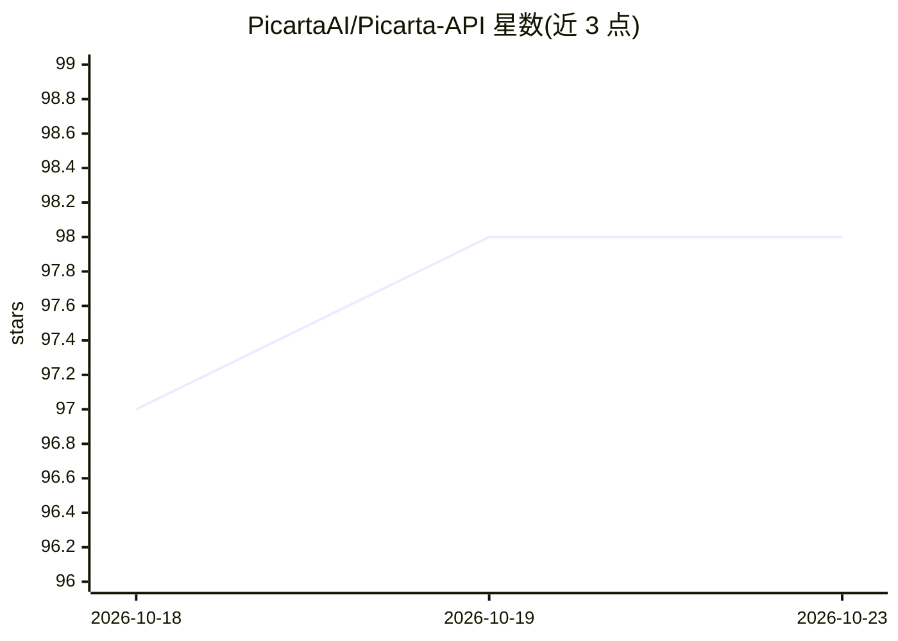

# PicartaAI/Picarta-API

⭐ 98 · MIT · 推送 2026-09-28 · [GitHub](https://github.com/PicartaAI/Picarta-API) · [官网](https://picarta.ai/api) · 组织维护

**图像地理定位 API 客户端：预测照片拍摄地点**

Picarta.ai 图像地理定位 API 的 Python 客户端包：上传本地图片或提供 URL，API 基于图片内容和/或嵌入元数据返回拍摄地点预测，包括城市、省、国家、GPS 坐标与置信度，默认返回 3 条（最多 10 条）。支持按国家、Admin1 区域、中心点加半径（最大 25km）缩小搜索范围，可读取 EXIF 中的 GPS 信息，并提供查询各国支持 Admin1 区域的接口。API 仅对企业账户开放，需邮件申请并使用 API 令牌；限制搜索未命中结果时不扣除额度。

## 筛选速览

| 维度 | 判定 | 备注 |
|---|---|---|
| AI 角色 | `ai-native` | 本体是模型或模型工具 |
| 许可风险 | `permissive` | MIT |
| 部署形态 | `library` | 以包/库形式分发 |
| 模型依赖 | — | README 未给出锁定关系 |
| 硬件要求 | — | 无带数字的原话,不猜 |
| 安装摩擦 | `low` | 无编译、无系统依赖或容器化 |
| 成熟度 | — | 结构信号不足 |

## 能力要点

- 基于图像内容与元数据返回 top-k 地点预测（城市/省/国家/GPS/置信度）
- 支持国家、Admin1 区域、中心点+半径（≤25km）位置过滤与搜索优先级
- 读取 EXIF 中的纬度/经度/国家信息（如存在）
- 提供 Admin1 区域查询接口与未命中不扣费机制

## 适用场景

- 我想知道一张照片是在哪里拍的
- OSINT 调查中定位图像的地理位置
- 在指定国家或区域范围内缩小图像定位搜索范围

## 场景标签

`语义搜索` · 领域:知识与检索

## 证据(README 行号)

> L3: Picarta.ai Image Geolocalization API 🌍🔍
> L7: The Picarta Image Geolocalization API allows users to localize images and obtain predictions about their geographic 

## 星数曲线

2026-10-18 97 → 2026-10-23 98（+1）

---
*卡片 v1 · prompt 1.4 · 生成 2026-10-23 · 置信度 high · 依据 README sha `c03d6c7bd5f3` · [字段定义](../../DATASET.md)*
