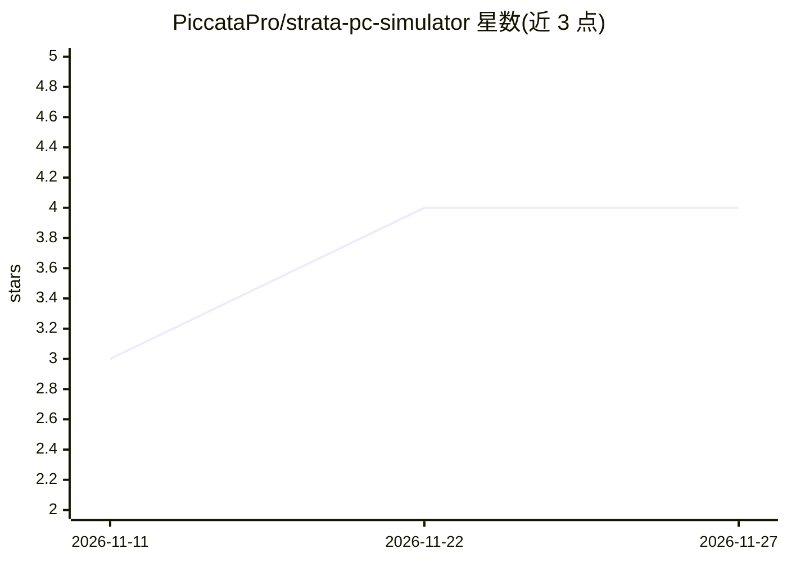

# PiccataPro/strata-pc-simulator

⭐ 4 · JavaScript · MIT · 推送 2026-11-06 · [GitHub](https://github.com/PiccataPro/strata-pc-simulator) · [官网](https://piccatapro.github.io/strata-pc-simulator/) · 个人维护 · 中文 README

**面向本地 MoE LLM 推理的 3D 装机模拟器：拖入硬件预测 tokens/sec**

用 Vanilla JS 与 Three.js 构建的单页 3D 装机模拟器：把真实硬件参数拖入机箱后按下电源，显示 decode/prefill 吞吐、TTFT、expert 驻留、温度与整机功耗，这些数值随硬件与推理设置（量化、上下文长度、并发）变化。性能模型由 Strata MoE 推理引擎的实测锚点机器解析求解得到，并用 36 项自动化检查防漂移。零运行时依赖，可构建为单 HTML 文件离线双击打开。作者声明为非官方社区工具，README 强调其为规划用途，绝对数值误差约 ±20%。

## 筛选速览

| 维度 | 判定 | 备注 |
|---|---|---|
| AI 角色 | `ai-enhanced` | 去掉 AI 部分产品仍成立 |
| 许可风险 | `permissive` | MIT |
| 部署形态 | `library` | 以包/库形式分发 |
| 模型依赖 | — | README 未给出锁定关系 |
| 硬件要求 | — | 无带数字的原话,不猜 |
| 安装摩擦 | `low` | 无编译、无系统依赖或容器化 |
| 成熟度 | — | 结构信号不足 |

## 能力要点

- 兼容性矩阵含 POST 规则与 PCIe 电气带宽、通道共享等陷阱
- 性能模型基于两台锚点实测解析求解，npm test 含 36 项回归检查
- 零运行时依赖，可构建为离线单文件 HTML
- 零件库为 parts.js 中的纯数据对象，可自行添加硬件

## 适用场景

- 升级 PC 前在屏幕上试装第二块 GPU 并预估对本地 LLM 推理速度的影响
- 检查内存、电源、PCIe 插槽等配件间的兼容性
- 对比不同 VRAM/内存/存储分层配置对 MoE 模型 expert 驻留的影响

## 场景标签

 · 领域:硬件模拟/PC 装机规划

## 证据(README 行号)

> L10: > **Unofficial community tool.** Not affiliated with the Strata project — this is a simulator *for* Strata, calibra
> L12: **A 3D PC builder that predicts your local LLM tokens/sec.**
> L30: This simulator encodes those rules as an explicit compatibility matrix and a time-model calibrated to real benchmar

## 星数曲线

2026-11-11 3 → 2026-11-27 4（+1）

---
*卡片 v1 · prompt 1.4 · 生成 2026-11-22 · 置信度 mid · 依据 README sha `940de1f255b7` · [字段定义](../../DATASET.md)*
