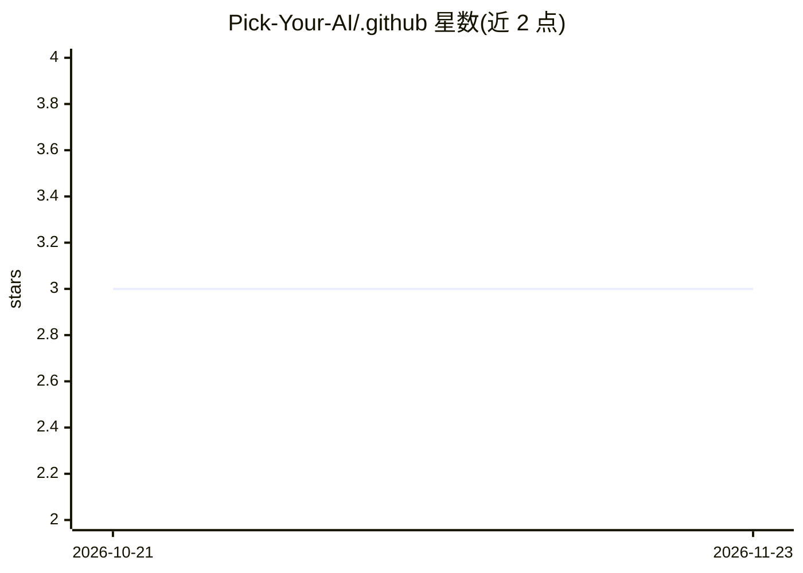

# Pick-Your-AI/.github

⭐ 3 · Python · 推送 2026-11-17 · [GitHub](https://github.com/Pick-Your-AI/.github) · [官网](https://github.com/Pick-Your-AI) · 组织维护

**Pick Your AI 组织的档案与社区治理文件仓库**

该仓库维护 Pick Your AI（一个受 PCPartPicker 启发的 AI 技术栈构建项目）的公开组织档案与共享社区文件：包含组织简介、行为准则、跨仓库的贡献与分支合并规则、命名规范、问题上报路由目录、治理决策与证据更新提案等。仓库本身不含可运行的 AI 功能，仅承载组织级 Markdown 文档、品牌资产（SVG 横幅、社交预览卡、头像）及其生成提示词记录；修改需通过分支加 PR 提交到 main。

## 筛选速览

| 维度 | 判定 | 备注 |
|---|---|---|
| AI 角色 | `ai-ecosystem` | LLM/agent 周边工具 |
| 许可风险 | `none` | — |
| 部署形态 | `None` |  |
| 模型依赖 | — | README 未给出锁定关系 |
| 硬件要求 | — | 无带数字的原话,不猜 |
| 安装摩擦 | `low` | 无编译、无系统依赖或容器化 |
| 成熟度 | — | 结构信号不足 |

## 能力要点

- 集中维护组织档案、行为准则、贡献规则与命名规范
- 问题上报的路由目录与治理边界说明
- 资产目录记录生成提示词、工具/模型披露与日期
- 附带 build_assets.py 用 Pillow 生成与压缩品牌图片

## 适用场景

- 了解 Pick Your AI 各仓库的分工与贡献流程
- 为该组织提交社区文件或品牌资产的修改
- 复用其组织档案与社区健康文件的组织方式

## 场景标签

 · 领域:开源社区治理/组织档案

## 证据(README 行号)

> L9: **Organization profile, contribution guidance, and shared community health files for Pick Your AI, a PCPartPicker-in
> L13: This repository maintains the public Pick Your AI organization profile and shared community guidance.
> L26: Web application work belongs in pick-your-ai-website. Research, evidence, and shared contracts belong in pick-your-

## 星数曲线

2026-10-21 3 → 2026-11-23 3（+0）

---
*卡片 v1 · prompt 1.4 · 生成 2026-11-22 · 置信度 mid · 依据 README sha `1df187cc3028` · [字段定义](../../DATASET.md)*
