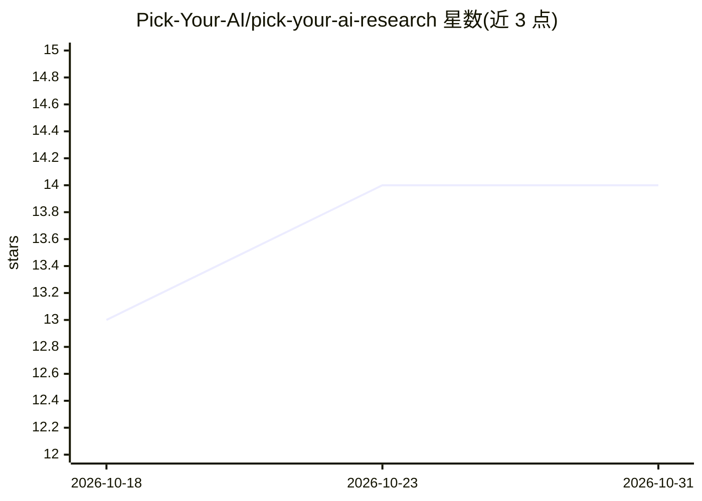

# Pick-Your-AI/pick-your-ai-research

⭐ 14 · Python · MIT · 推送 2026-10-30 · [GitHub](https://github.com/Pick-Your-AI/pick-your-ai-research) · [官网](https://github.com/orgs/Pick-Your-AI/projects/1) · 组织维护

**AI 系统选型规划工具的研究与数据契约仓库（类 PCPartPicker）**

Pick Your AI 组织的研究工作区：为仿 PCPartPicker 的 AI 系统搭建器提供组件目录、兼容性规则、定价与证据数据。以 schema 契约 1.0.0 组织 T0–T6 技术工作流（配置、模型选型、基础设施、检索、Agent、训练、运维）与 MR-01~12 市场研究流，另含 Android/Apple 客户端交付规划与贡献者排行榜计划。面向研究贡献者，提交经 PR 与 issue 验收流程，仓库声明不含已交付产品。

## 筛选速览

| 维度 | 判定 | 备注 |
|---|---|---|
| AI 角色 | `ai-knowledge` | 知识聚合/清单类 |
| 许可风险 | `permissive` | MIT |
| 部署形态 | `library` | 以包/库形式分发 |
| 模型依赖 | — | README 未给出锁定关系 |
| 硬件要求 | — | 无带数字的原话,不猜 |
| 安装摩擦 | `low` | 无编译、无系统依赖或容器化 |
| 成熟度 | — | 结构信号不足 |

## 能力要点

- 统一契约 1.0.0（schema、组件类型注册表、issue 映射）
- T0–T6 七条技术工作流与依赖关系图研究
- 12 条市场研究工作流（竞品、定价、MVP 范围等）
- 贡献需运行 Python 3.12 单元测试与结构校验

## 适用场景

- 为 AI 组件选型工具贡献组件目录与定价数据
- 查阅 AI 技术栈各层的兼容性规则与选型研究
- 按模板提交技术与市场研究并跟踪验收状态

## 场景标签

 · 领域:AI 基础设施/选型研究

## 证据(README 行号)

> L11: **Research and shared data contracts for Pick Your AI: component catalogs, compatibility rules, pricing, and eviden
> L17: Research for an AI system builder inspired by PCPartPicker: choose compatible AI components, compare costs and trad

## 星数曲线

2026-10-18 13 → 2026-10-31 14（+1）

---
*卡片 v1 · prompt 1.4 · 生成 2026-10-31 · 置信度 high · 依据 README sha `320b45a65a2f` · [字段定义](../../DATASET.md)*
