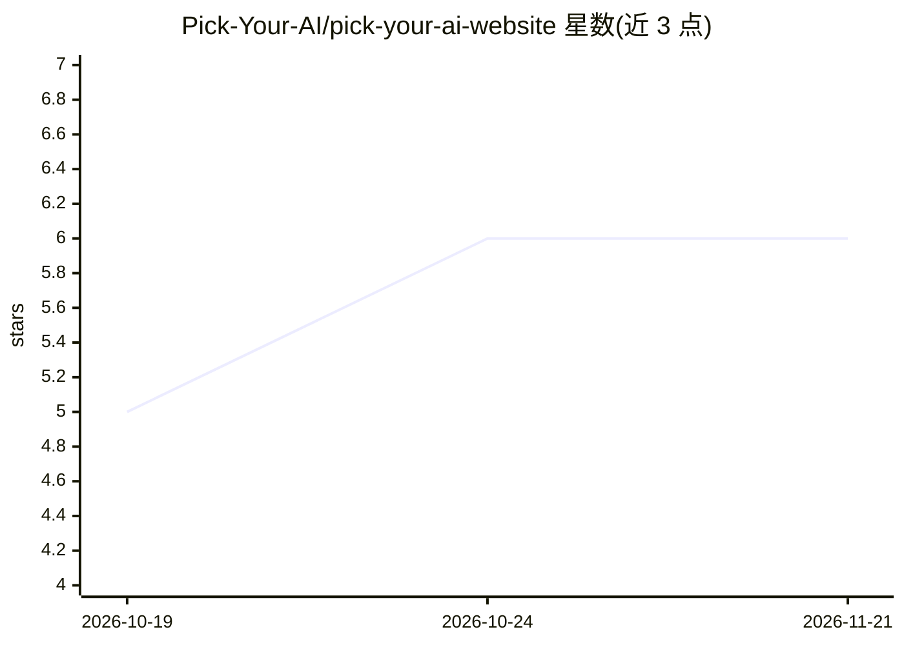

# Pick-Your-AI/pick-your-ai-website

⭐ 6 · TypeScript · MIT · 推送 2026-11-20 · [GitHub](https://github.com/Pick-Your-AI/pick-your-ai-website) · [官网](https://pickyour.ai) · 组织维护

**AI 全栈组件选型构建器：按兼容性与成本逐件搭配**

受 PCPartPicker 启发的 AI 技术栈构建网站：用户先选择工作负载与部署方式，再逐层挑选模型、基础设施、数据、工具与部署方案，构建过程中实时给出兼容性检查结果（pass/fail/unknown/skipped 枚举）与成本展示。当前处于预览阶段，组件目录、价格与兼容性结果均为标注过的合成演示数据；兼容性规则由独立 research 仓库的契约文件驱动。技术栈为 React 19 + TypeScript + Vite，构建为静态站点部署。

## 筛选速览

| 维度 | 判定 | 备注 |
|---|---|---|
| AI 角色 | `ai-knowledge` | 知识聚合/清单类 |
| 许可风险 | `permissive` | MIT |
| 部署形态 | `None` |  |
| 模型依赖 | — | README 未给出锁定关系 |
| 硬件要求 | — | 无带数字的原话,不猜 |
| 安装摩擦 | `low` | 无编译、无系统依赖或容器化 |
| 成熟度 | `idea` | |

## 能力要点

- 按工作负载与部署方式逐层搭配 AI 栈组件
- 契约驱动的兼容性评估，含 pass/fail/unknown/skipped 判定
- 未知信息不视为兼容的保守判定规则
- 静态 SPA，以 Apache 托管于共享主机

## 适用场景

- 在搭建 AI 应用前试算一套完整技术栈的组合与成本
- 检查模型、基础设施与工具之间的兼容性
- 浏览 AI 栈组件目录（当前为合成数据演示）

## 场景标签

 · 领域:开发工具/AI 基础设施

## 证据(README 行号)

> L16: **Build a compatible AI stack, part by part.** PickYour.AI is a builder for
> L29: > **Preview status.** The real component catalog is still being researched.
> L63: This repository is the website frontend and build tooling for PickYour.AI. It

## 星数曲线

2026-10-19 5 → 2026-11-21 6（+1）

---
*卡片 v1 · prompt 1.4 · 生成 2026-11-20 · 置信度 mid · 依据 README sha `3bf6620ec237` · [字段定义](../../DATASET.md)*
