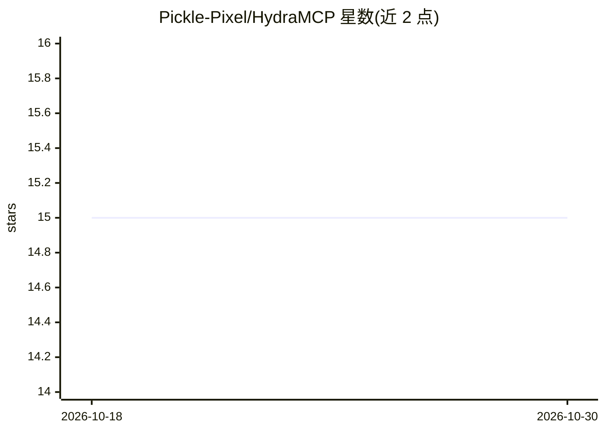

# Pickle-Pixel/HydraMCP

⭐ 15 · TypeScript · MIT · 推送 2026-02-08 · [GitHub](https://github.com/Pickle-Pixel/HydraMCP) · 个人维护

**让 Claude Code 统一调用多家 LLM 的 MCP 服务器**

TypeScript 编写的 MCP 服务器，接入 Claude Code 后可通过 API Key、订阅计划（ChatGPT Plus/Claude Pro/Gemini Advanced 的 CLI）和本地 Ollama 三种方式查询 GPT、Gemini、Claude 及本地模型，并提供 compare_models（2-5 模型并行对比）、consensus（3-7 模型投票，LLM-as-judge 评估一致性）、synthesize（多模型答案合成）等 8 个工具。SmartProvider 层提供熔断器、15 分钟响应缓存、指标统计与响应蒸馏。通过 npx 或 git clone 源码安装，MIT 许可。

## 筛选速览

| 维度 | 判定 | 备注 |
|---|---|---|
| AI 角色 | `ai-ecosystem` | LLM/agent 周边工具 |
| 许可风险 | `permissive` | MIT |
| 部署形态 | `library` | 以包/库形式分发 |
| 模型依赖 | local-ok | 支持本地模型 |
| 硬件要求 | — | 无带数字的原话,不猜 |
| 安装摩擦 | `low` | 无编译、无系统依赖或容器化 |
| 成熟度 | — | 结构信号不足 |

## 能力要点

- 三种接入方式可混用：API Key、订阅 CLI、本地 Ollama
- compare/vote/synthesize 三种多模型协作工具
- SmartProvider 层：熔断器、SHA-256 响应缓存、指标、响应蒸馏
- npx hydramcp setup 交互式向导自动安装并认证各 CLI

## 适用场景

- 在 Claude Code 中让多个模型对比评审同一段代码
- 用本地模型做 judge 裁决多个云端模型的回答
- 复用已有 ChatGPT/Claude/Gemini 订阅而无需 API 计费

## 场景标签

`模型网关` · 领域:Agent 开发

## 证据(README 行号)

> L4: An MCP server that lets Claude Code query any LLM — compare, vote, and synthesize across GPT, Gemini, Claude, and lo
> L68:     HydraMCP (MCP Server)
> L51: |**consensus**|Poll 3-7 models, LLM-as-judge evaluates agreement|

## 星数曲线

2026-10-18 15 → 2026-10-30 15（+0）

---
*卡片 v1 · prompt 1.4 · 生成 2026-10-30 · 置信度 high · 依据 README sha `ed69a0ab5a74` · [字段定义](../../DATASET.md)*
