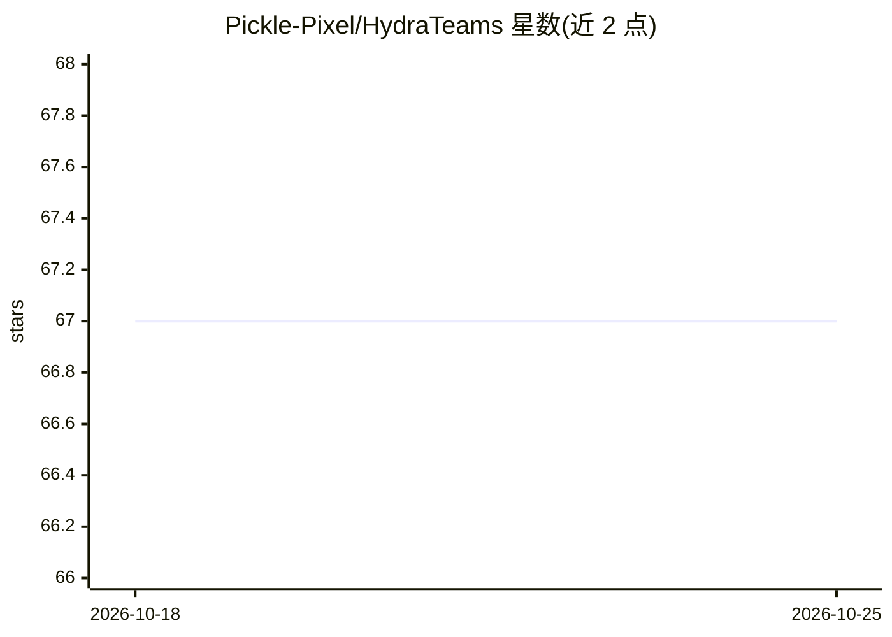

# Pickle-Pixel/HydraTeams

⭐ 67 · TypeScript · MIT · 推送 2026-02-08 · [GitHub](https://github.com/Pickle-Pixel/HydraTeams) · 个人维护

**让 Claude Code Agent Teams 使用任意模型的翻译代理**

TypeScript 编写的本地翻译代理：拦截 Claude Code Agent Teams 发出的 Anthropic Messages API 请求，转换为 OpenAI 等提供商格式，使队友进程由 GPT 等模型驱动，同时保留 Claude Code 的全部工具（Read/Write/Bash/Git 等）。通过 CLAUDE.md 标记区分 lead 与 teammate，lead 可直通真实 Anthropic API 并中继订阅认证头。当前已测试的提供商为 OpenAI API 与 ChatGPT 订阅（经 codex 登录），Gemini/Ollama 仅在描述中列举。零运行时依赖，git clone 后 npm 构建运行。

## 筛选速览

| 维度 | 判定 | 备注 |
|---|---|---|
| AI 角色 | `ai-ecosystem` | LLM/agent 周边工具 |
| 许可风险 | `permissive` | MIT |
| 部署形态 | `library` | 以包/库形式分发 |
| 模型依赖 | — | README 未给出锁定关系 |
| 硬件要求 | — | 无带数字的原话,不猜 |
| 安装摩擦 | `low` | 无编译、无系统依赖或容器化 |
| 成熟度 | `idea` | |

## 能力要点

- 拦截并翻译 Anthropic Messages API 请求至 OpenAI 等提供商格式
- lead/teammate 混合路由：lead 直通真实 Claude，teammate 用目标模型
- 复用 ChatGPT Plus 订阅认证，lead 直通无需 API key
- 零运行时依赖，TypeScript + Node.js 内置模块

## 适用场景

- 在 Claude Code Agent Teams 中用 GPT 模型作为队友完成编码任务
- 按任务类型路由不同模型以控制成本
- 利用已有 ChatGPT Plus 订阅运行多智能体队伍

## 场景标签

`多智能体` `模型网关` · 领域:Agent 开发

## 证据(README 行号)

> L5: A translation proxy that lets Claude Code Agent Teams use any AI model as a teammate. GPT Codex, Gemini, Ollama: the
> L20: Claude Code Agent Teams spawns teammates as separate Claude Code processes. Each teammate communicates with its LLM

## 星数曲线

2026-10-18 67 → 2026-10-25 67（+0）

---
*卡片 v1 · prompt 1.4 · 生成 2026-10-24 · 置信度 high · 依据 README sha `3f80de046bcb` · [字段定义](../../DATASET.md)*
