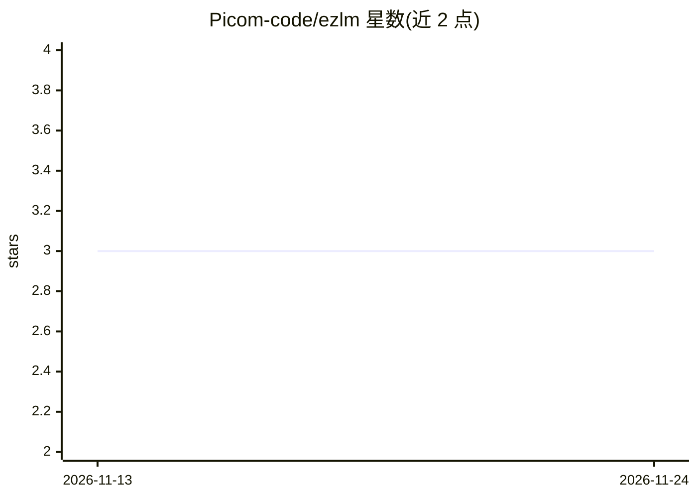

# Picom-code/ezlm

⭐ 3 · HTML · 推送 2026-11-13 · [GitHub](https://github.com/Picom-code/ezlm) · [官网](https://picom-code.github.io/ezlm/) · 个人维护

**本地运行自己的大模型，自动选型并给出 OpenAI 兼容接口**

EZLM 是一款 Windows/macOS 桌面应用：扫描本机 CPU、内存、显卡与磁盘后自动挑选能流畅运行的模型，下载 AI 引擎与模型权重，启动本地服务并颁发私有 URL 与 API key。内置聊天界面且可查看/编辑记忆内容，对外暴露 OpenAI 兼容 API，支持模型热切换与按设备管理密钥。当前为 beta 版、未签名安装包，安装时需手动绕过系统提示；Smart App Control 开启时 Windows 11 会直接拦截。

## 筛选速览

| 维度 | 判定 | 备注 |
|---|---|---|
| AI 角色 | `ai-ecosystem` | LLM/agent 周边工具 |
| 许可风险 | `none` | — |
| 部署形态 | `desktop` | 安装包/桌面程序 |
| 模型依赖 | — | README 未给出锁定关系 |
| 硬件要求 | — | 无带数字的原话,不猜 |
| 安装摩擦 | `low` | 无编译、无系统依赖或容器化 |
| 成熟度 | `idea` | |

## 能力要点

- 扫描硬件并自动选择可流畅运行的模型，提供 Balanced/Smartest/Fastest 模式
- OpenAI 兼容 API（http://127.0.0.1:8080/v1），可供任何支持该协议的应用调用
- 内置聊天并支持查看和编辑模型保留的对话内容
- 模型热切换：地址与密钥不变，旧模型在新模型下载期间继续应答

## 适用场景

- 在本地电脑离线运行大模型并内置聊天
- 给支持 OpenAI API 的工具接一个本地模型后端
- 无需命令行部署本地推理服务

## 场景标签

`推理引擎` · 领域:训练与推理

## 证据(README 行号)

> L11: Your own AI model, running on your own computer. EZLM checks your machine, picks the smartest model it can
> L19: 4. **Ready.** Chat in EZLM right away, or use your URL and key in any app that speaks the OpenAI API.
> L38:     base_url="http://127.0.0.1:8080/v1",

## 星数曲线

2026-11-13 3 → 2026-11-24 3（+0）

---
*卡片 v1 · prompt 1.4 · 生成 2026-11-22 · 置信度 high · 依据 README sha `69d4b0f86fe4` · [字段定义](../../DATASET.md)*
