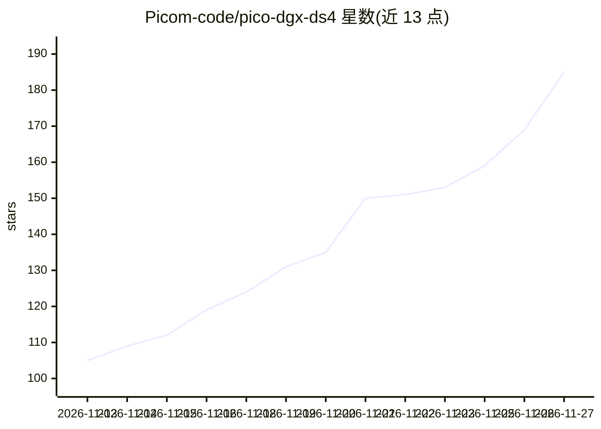

# Picom-code/pico-dgx-ds4

⭐ 185 · Cuda · MIT · 推送 2026-11-20 · [GitHub](https://github.com/Picom-code/pico-dgx-ds4) · 个人维护

**在 4 台 DGX Spark 上分摊运行 DeepSeek V4.1 Flash 的推理引擎分支**

blaesus/dsgx10 推理引擎的分支，将 DeepSeek V4.1 Flash 部署在 4 台 NVIDIA GB10 设备上以 TP4 方式运行，支持多用户共享（16 slot，4×1M+12×128K 上下文）、稀疏注意力索引扩至 1M 上下文、OpenAI API 形式的图像输入（ViR 侧编码器）、直连 all-reduce（stack5）与单用户小优化（stack4）。README 给出 SPEED-Bench/AIPerf 基准数字、与 SGLang/MiaAI kit 的对比表，并要求 4×DGX Spark 与 ConnectX-7/RoCE 交换机布线。

## 筛选速览

| 维度 | 判定 | 备注 |
|---|---|---|
| AI 角色 | `ai-ecosystem` | LLM/agent 周边工具 |
| 许可风险 | `permissive` | MIT |
| 部署形态 | `None` |  |
| 模型依赖 | locked-api |  |
| 硬件要求 | — | 无带数字的原话,不猜 |
| 安装摩擦 | `low` | 无编译、无系统依赖或容器化 |
| 成熟度 | — | 结构信号不足 |

## 能力要点

- 4 台 DGX Spark TP4 运行 DeepSeek V4.1 Flash，16 用户共享一个集群
- 稀疏注意力索引扩展到 1M 上下文，slot 最小适配准入
- 经 OpenAI API 支持 image_url 图像输入（侧编码器约 1 GB 显存）
- RoCE 交换机直连 all-reduce，省去中继跳

## 适用场景

- 让多名用户共享一套 4 机 DGX Spark 推理集群
- 本地长上下文（至 1M）与图像输入的模型服务
- 在 GB10 设备上复现 README 中的基准数字

## 场景标签

`推理引擎` · 领域:训练与推理

## 证据(README 行号)

> L87: This is the exact build behind the numbers above (the engine source in this repo is the source of the binary we ser
> L127: From-scratch inference engines for NVIDIA GB10 boxes.
> L129: specialised to it: speed over generality. Each is self-contained, with its own engine, front-end,

## 星数曲线

2026-11-13 105 → 2026-11-27 185（+80）

---
*卡片 v1 · prompt 1.4 · 生成 2026-11-26 · 置信度 high · 依据 README sha `39613939e06c` · [字段定义](../../DATASET.md)*
