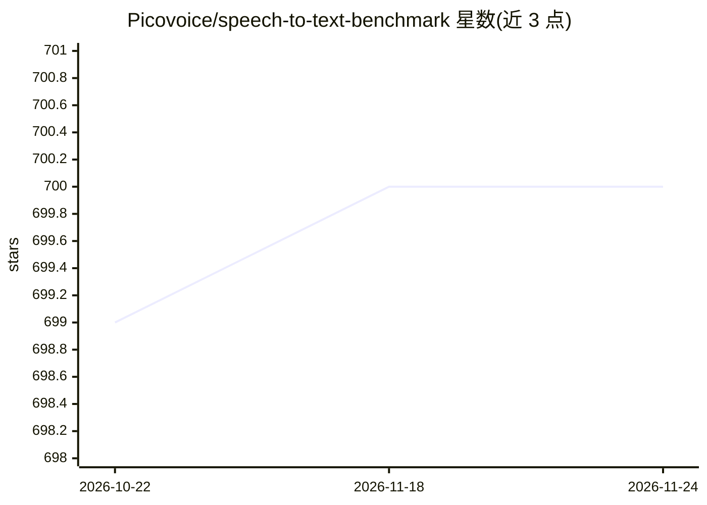

# Picovoice/speech-to-text-benchmark

⭐ 700 · Python · Apache-2.0 · 推送 2026-11-16 · [GitHub](https://github.com/Picovoice/speech-to-text-benchmark) · [官网](https://picovoice.ai/) · 组织维护

**对多个语音识别引擎进行基准测试的框架**

由 Picovoice 维护的语音识别基准测试框架，用于在统一流程下评测不同语音转文本引擎。支持 LibriSpeech、Common Voice、AISHELL-2 等多语言数据集，覆盖英、法、德、中、日、韩等 10 种语言；指标包括词错率、字符错率、标点错率、Core-Hour 计算量、词发射延迟、峰值内存与模型体积。以 Python 脚本运行，按引擎给出命令行用法，云引擎需提供各自账户凭据。

## 筛选速览

| 维度 | 判定 | 备注 |
|---|---|---|
| AI 角色 | `ai-ecosystem` | LLM/agent 周边工具 |
| 许可风险 | `permissive` | Apache-2.0 |
| 部署形态 | `library` | 以包/库形式分发 |
| 模型依赖 | — | README 未给出锁定关系 |
| 硬件要求 | — | 无带数字的原话,不猜 |
| 安装摩擦 | `medium` | 含编译或系统依赖之一 |
| 成熟度 | — | 结构信号不足 |

## 能力要点

- 评测 12 个语音识别引擎（含云端与本地流式引擎）
- 7 项指标：WER/CER/PER、Core-Hour、词发射延迟、峰值内存、模型体积
- 支持 11 个数据集、10 种语言的基准流程
- 区分流式引擎的延迟基准（benchmark_latency.py）

## 适用场景

- 对比不同语音识别引擎在目标语言数据集上的错误率
- 评估本地引擎的计算量与内存占用以做设备选型参考
- 测量流式引擎的词发射延迟

## 场景标签

`模型评测` · 领域:评测与运维

## 证据(README 行号)

> L5: This repo is a minimalist and extensible framework for benchmarking different speech-to-text engines.
> L62: ## Engines

## 星数曲线

2026-10-22 699 → 2026-11-24 700（+1）

---
*卡片 v1 · prompt 1.4 · 生成 2026-11-24 · 置信度 high · 依据 README sha `4cd4066485f6` · [字段定义](../../DATASET.md)*
