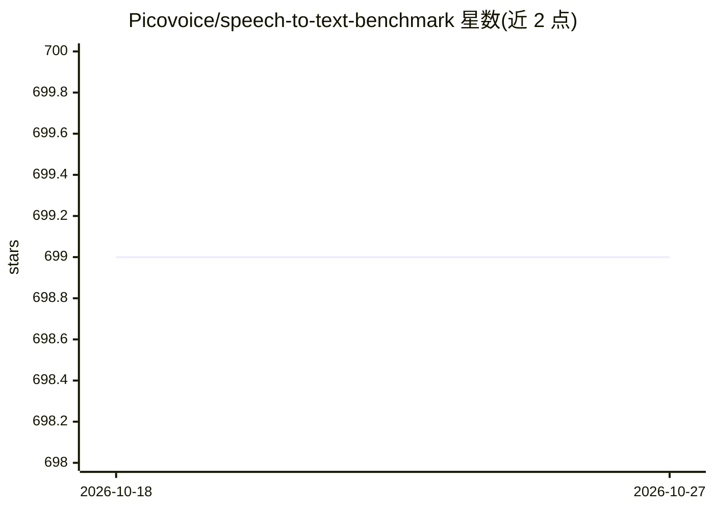

# Picovoice/speech-to-text-benchmark

⭐ 699 · Python · Apache-2.0 · 推送 2026-10-07 · [GitHub](https://github.com/Picovoice/speech-to-text-benchmark) · [官网](https://picovoice.ai/) · 组织维护

**语音转文字引擎的基准测试框架：跨引擎评测 WER/CER/延迟**

Picovoice 维护的语音转文字（STT）引擎基准测试框架，面向开发者与科研人员。支持 Amazon Transcribe、Azure、Google、IBM Watson、OpenAI Whisper、Whisper.cpp、Vosk、Moonshine、Nemotron 3.5 ASR 及 Picovoice Cheetah/Leopard 等引擎，在 LibriSpeech、TED-LIUM、Common Voice、Fleurs 等数据集上计算 WER/CER/标点错误率、Core-Hour、词发射延迟与模型大小。在 Ubuntu 22.04 + Python 3.12 上开发测试，需安装 FFmpeg 并下载数据集。

## 筛选速览

| 维度 | 判定 | 备注 |
|---|---|---|
| AI 角色 | `ai-ecosystem` | LLM/agent 周边工具 |
| 许可风险 | `permissive` | Apache-2.0 |
| 部署形态 | `library` | 以包/库形式分发 |
| 模型依赖 | — | README 未给出锁定关系 |
| 硬件要求 | — | 无带数字的原话,不猜 |
| 安装摩擦 | `medium` | 含编译或系统依赖之一 |
| 成熟度 | — | 结构信号不足 |

## 能力要点

- 覆盖 11 个云端与本地 STT 引擎，含流式延迟测试
- 指标含 WER/CER/PER、Core-Hour、词发射延迟与模型大小
- 支持 9 种语言与 10 个公开数据集
- 延迟基准需先生成词级时间对齐信息

## 适用场景

- 对比各语音识别引擎在标准数据集上的错误率
- 评估流式 STT 引擎的词发射延迟
- 比较本地引擎的计算效率（Core-Hour）与模型大小

## 场景标签

`模型评测` · 领域:评测与运维

## 证据(README 行号)

> L5: This repo is a minimalist and extensible framework for benchmarking different speech-to-text engines.
> L52: ## Engines

## 星数曲线

2026-10-18 699 → 2026-10-27 699（+0）

---
*卡片 v1 · prompt 1.4 · 生成 2026-10-21 · 置信度 high · 依据 README sha `b00215d0923a` · [字段定义](../../DATASET.md)*
