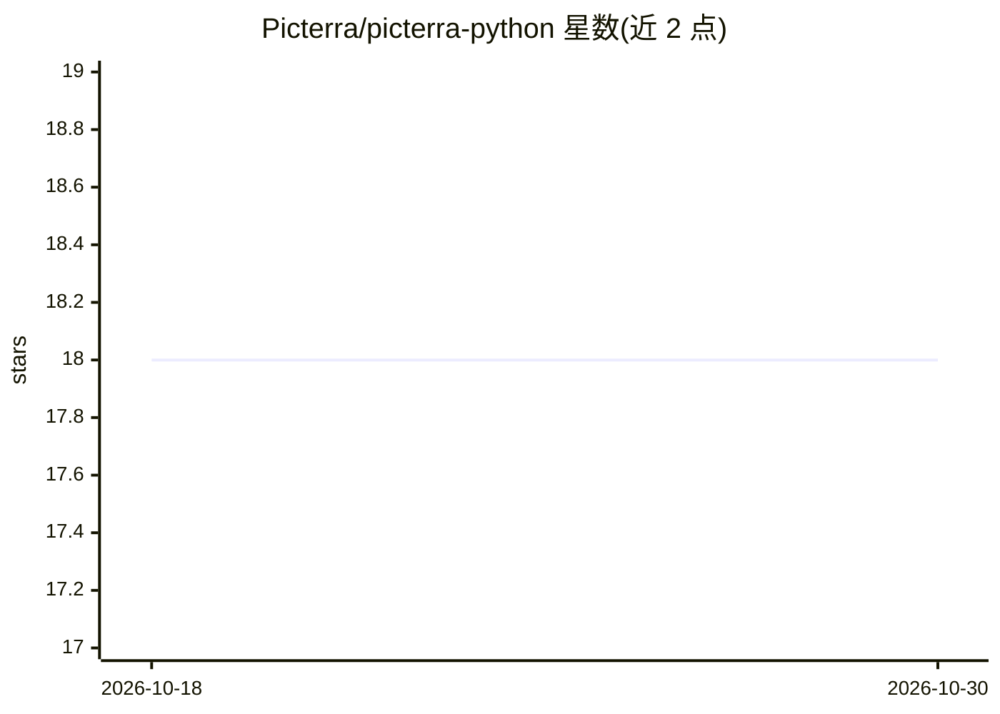

# Picterra/picterra-python

⭐ 18 · Python · MIT · 推送 2026-07-28 · [GitHub](https://github.com/Picterra/picterra-python) · [官网](https://picterra.ch) · 组织维护

**Picterra 地理空间 ML 平台的 Python API 客户端**

Picterra 官方维护的 Python 客户端库：通过 APIClient 封装对 Picterra 云端机器学习检测器（detector）的调用，供开发者在自己的应用或脚本中提交遥感影像、运行检测器并获取结果。README 仅给出 pip 安装、examples 示例目录、Read the Docs 文档入口，以及开发流程（虚拟环境、pytest 测试、Sphinx 文档构建、发布到 PyPI 的流程）。模型运行依赖 Picterra 云服务，本地不加载模型。

## 筛选速览

| 维度 | 判定 | 备注 |
|---|---|---|
| AI 角色 | `ai-ecosystem` | LLM/agent 周边工具 |
| 许可风险 | `permissive` | MIT |
| 部署形态 | `library` | 以包/库形式分发 |
| 模型依赖 | — | README 未给出锁定关系 |
| 硬件要求 | — | 无带数字的原话,不猜 |
| 安装摩擦 | `low` | 无编译、无系统依赖或容器化 |
| 成熟度 | — | 结构信号不足 |

## 能力要点

- APIClient 封装对云端 detector 的调用
- 提供 examples 文件夹示例
- 通过 PyPI 发布，pip install picterra 安装
- 附 Read the Docs 用户指南与 API 参考

## 适用场景

- 在自己的应用中调用 Picterra 检测器处理遥感影像
- 脚本化批量运行地理空间 ML 检测任务
- 将 Picterra 结果集成到数据科学工作流

## 场景标签

`目标检测` · 领域:感知与多模态

## 证据(README 行号)

> L7: # Picterra Python API Client
> L13: Easily integrate state-of-the-art machine learning models in your app
> L16: from picterra import APIClient

## 星数曲线

2026-10-18 18 → 2026-10-30 18（+0）

---
*卡片 v1 · prompt 1.4 · 生成 2026-10-29 · 置信度 high · 依据 README sha `441f9d125647` · [字段定义](../../DATASET.md)*
