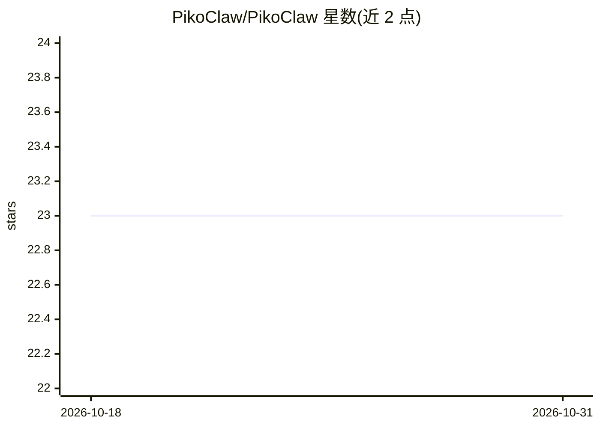

# PikoClaw/PikoClaw

⭐ 23 · Rust · Apache-2.0 · 推送 2026-04-09 · [GitHub](https://github.com/PikoClaw/PikoClaw) · [官网](https://pikoclaw.com) · 组织维护

**Rust 编写的开源 AI 编程 agent CLI，面向开发者**

用 Rust 实现的终端 AI 编程助手，设计规格源自对 Claude Code 泄露源码的研究。体积约 6-7 MB，通过 Anthropic 标准 API 或任何 Anthropic 兼容 API（Bearer 认证，如 OpenRouter）接入多种 LLM。内置约 30 个工具：文件读写编辑、Bash/PowerShell、Web 抓取与搜索、后台任务与 cron 调度、多 agent 消息、Git worktree 切换等；支持主题切换、/model 换模型、/compact 压缩历史，并可通过 Markdown 文件添加自定义技能。提供 curl 安装脚本、Homebrew 与多平台二进制，源码构建需 Rust 1.80+。

## 筛选速览

| 维度 | 判定 | 备注 |
|---|---|---|
| AI 角色 | `ai-native` | 本体是模型或模型工具 |
| 许可风险 | `permissive` | Apache-2.0 |
| 部署形态 | `desktop` | 安装包/桌面程序 |
| 模型依赖 | locked-api |  |
| 硬件要求 | — | 无带数字的原话,不猜 |
| 安装摩擦 | `medium` | 含编译或系统依赖之一 |
| 成熟度 | — | 结构信号不足 |

## 能力要点

- ~6-7 MB Rust 单二进制，支持 Anthropic 兼容 API 的第三方供应商（OpenRouter 等）
- 内置文件编辑、Shell、Web、任务调度（cron）、多 agent 通信等约 30 个工具
- Git worktree 隔离工作区（EnterWorktree/ExitWorktree）
- Markdown 文件扩展自定义技能，/compact 压缩对话历史

## 适用场景

- 在终端用自然语言完成代码阅读、修改与 Shell 操作
- 通过 OpenRouter 等第三方供应商免 Anthropic key 使用多种模型
- 用后台任务与 cron 调度自动化重复工作

## 场景标签

`编码 Agent` · 领域:编码与开发

## 证据(README 行号)

> L16: The Open Source High-performance AI agent for developers, written in Rust. Inspired from Claude Code leak ; )
> L18: Ultra lightweight (~6-7 MB) and blazing fast. All LLMs are Supported i.e. `Anthropic`, `OpenAI`, `Google`, `OpenRou
> L152: ## Built-in Tools

## 星数曲线

2026-10-18 23 → 2026-10-31 23（+0）

---
*卡片 v1 · prompt 1.4 · 生成 2026-10-27 · 置信度 high · 依据 README sha `37cf3bea3528` · [字段定义](../../DATASET.md)*
