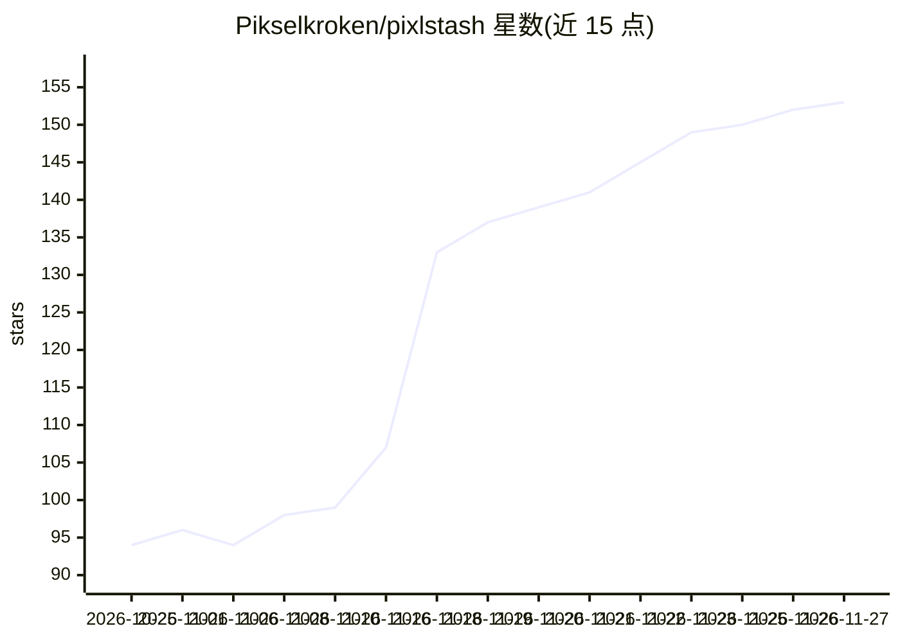

# Pikselkroken/pixlstash

⭐ 153 · Python · GPL-3.0 · 推送 2026-11-26 · [GitHub](https://github.com/Pikselkroken/pixlstash) · [官网](http://pixlstash.dev/) · 个人维护

**给摄影师和创作者的桌面图片库：本地 AI 搜索、打标与生成**

PixlStash 是面向摄影师与创作者的图片库桌面应用，用于搜索、打标、评分和整理大型图片集合，另提供带完整浏览器界面的 headless 服务器形态。AI 部分包括 CLIP 语义搜索（含图片内文字）、InsightFace 人脸识别分组、多种打标/描述引擎、对象检测与分割，以及异常检测评分。全部模型在本机运行、无云 API，可连接 ComfyUI 做生成与编辑、用 AI-toolkit 训练 LoRA，并支持 GPU 调度与多库管理。

## 筛选速览

| 维度 | 判定 | 备注 |
|---|---|---|
| AI 角色 | `ai-native` | 本体是模型或模型工具 |
| 许可风险 | `viral` | GPL-3.0 |
| 部署形态 | `desktop` | 安装包/桌面程序 |
| 模型依赖 | local-ok | 支持本地模型 |
| 硬件要求 | `cpu-ok` | |
| 安装摩擦 | `low` | 无编译、无系统依赖或容器化 |
| 成熟度 | — | 结构信号不足 |

## 能力要点

- CLIP（OpenCLIP ViT-B-32）语义搜索覆盖全库，含图片内文字的匹配
- InsightFace 人脸检测与识别并按人物分组，支持按人脸/相似度搜索
- 双向 ComfyUI 集成与工作流卡片、recipe 保存复用，接入 AI-toolkit 训练 LoRA
- 全部模型在本机硬件运行（CPU/CUDA/Apple Silicon/ROCm），无云 API

## 适用场景

- 整理包含大量人像的图片集合并按人物检索
- 批量给图片打标签和描述，并通过复核队列校对自动标签
- 在图库内直接调用 ComfyUI 工作流生成、重绘和放大图片
- 从某个人物或集合出发训练 LoRA 并跟踪训练进度

## 场景标签

`语义搜索` `人脸识别` `图像生成` `微调` · 领域:内容生成

## 证据(README 行号)

> L13: PixlStash is an image library for photographers and creators. It searches,
> L40: - Semantic search with CLIP (OpenCLIP ViT-B-32) across the whole library,
> L57: - Every model runs on your own hardware: the CPU, an NVIDIA GPU (CUDA), the

## 星数曲线

2026-10-25 94 → 2026-11-27 153（+59）

---
*卡片 v1 · prompt 1.4 · 生成 2026-11-27 · 置信度 low · 依据 README sha `11c098d41d7f` · [字段定义](../../DATASET.md)*
