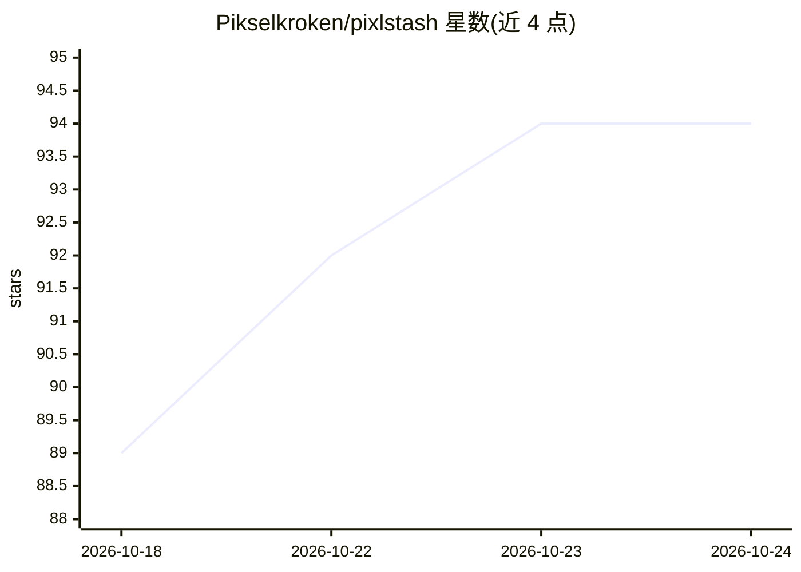

# Pikselkroken/pixlstash

⭐ 94 · Python · GPL-3.0 · 推送 2026-10-24 · [GitHub](https://github.com/Pikselkroken/pixlstash) · [官网](http://pixlstash.dev/) · 个人维护

**本地图片库服务器：自动打标签、语义搜索与人脸识别管理大图库**

PixlStash 是运行在本机的图片库服务器，支持桌面应用、浏览器界面或无头服务器部署。核心功能：CLIP 语义搜索（OpenCLIP ViT-B-32）、InsightFace 人脸检测/识别/自动分组与反向人脸搜索、多种引擎可选的自动打标签与图片描述（WD14、Florence-2、JoyCaption 等）、分割、质量与异常评分、标签审核队列。所有模型本地运行（CPU/CUDA/实验性 ROCm），无云 API。提供 REST API、ComfyUI 双向集成、多库管理与 zstd 备份，以桌面安装包、Docker 镜像和 pip 包形式分发。

## 筛选速览

| 维度 | 判定 | 备注 |
|---|---|---|
| AI 角色 | `ai-native` | 本体是模型或模型工具 |
| 许可风险 | `viral` | GPL-3.0 |
| 部署形态 | `desktop` | 安装包/桌面程序 |
| 模型依赖 | — | README 未给出锁定关系 |
| 硬件要求 | — | 无带数字的原话,不猜 |
| 安装摩擦 | `low` | 无编译、无系统依赖或容器化 |
| 成熟度 | — | 结构信号不足 |

## 能力要点

- CLIP 文本语义搜索与 InsightFace 人脸识别/分组
- 多引擎可选的自动打标签与图片描述
- 标签审核队列与标签健康看板
- 双向 ComfyUI 集成与 REST API

## 适用场景

- 整理失控的图片库，按内容或人脸搜索图片
- 审核自动标签，按质量/异常评分筛选图片
- 作为 ComfyUI 工作流的数据源，对选中图片运行工作流

## 场景标签

`语义搜索` `人脸识别` · 领域:知识与检索

## 证据(README 行号)

> L10: - Semantic search across the whole library with CLIP text queries, tagged or not (OpenCLIP ViT-B-32)
> L12: - Automatic tagging and image descriptions with selectable AI engines (our own PixlStash Tagger, WD14, Florence-2, 
> L16: - Every model runs on your own hardware (CPU, NVIDIA CUDA, or experimental AMD ROCm). No cloud API

## 星数曲线

2026-10-18 89 → 2026-10-24 94（+5）

---
*卡片 v1 · prompt 1.4 · 生成 2026-10-23 · 置信度 high · 依据 README sha `9a419dfe63dd` · [字段定义](../../DATASET.md)*
