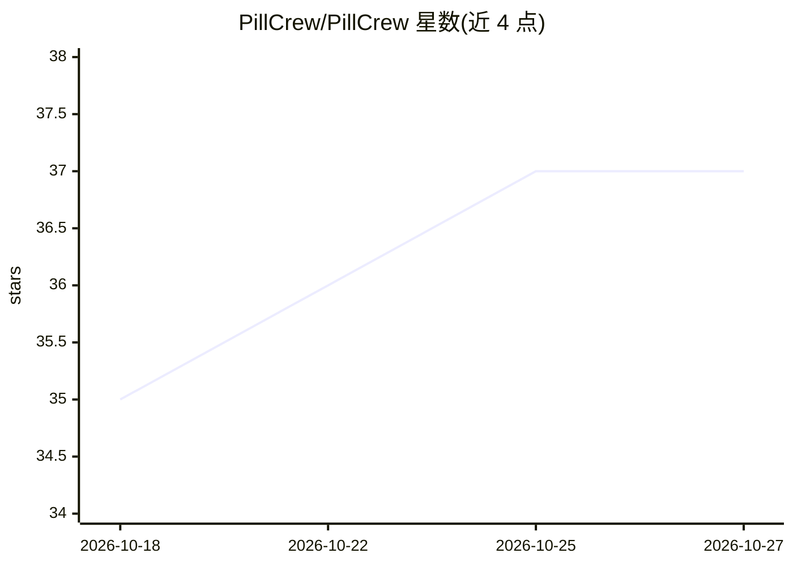

# PillCrew/PillCrew

⭐ 37 · JavaScript · MIT · 推送 2026-10-24 · [GitHub](https://github.com/PillCrew/PillCrew) · [官网](https://pillcrew.fun) · 个人维护

**Solana memecoin 交易 AI 副驾：桌面宠物 Pilly 与 AI 分析团队**

个人主页式 README，介绍多个项目：核心为 Pilly Desktop——常驻任务栏/菜单栏的桌面宠物 AI，支持对话（免费 AI）、粘贴 Solana 代币获取实时行情解读，附带热门币、投资组合、自选与 PnL、巨鲸跟踪、仓位计算等功能，支持 Windows/macOS/Linux。另有网页平台 pillcrew.fun：十个 AI 专家对任意 Solana 代币给出分析与 Crew Verdicts、图表、价格警报。还列出 deedchain、claimchain 等 GitHub 项目。README 未给出安装命令，仅指向 Release 下载；声明仅供教育娱乐、非财务建议。

## 筛选速览

| 维度 | 判定 | 备注 |
|---|---|---|
| AI 角色 | `ai-enhanced` | 去掉 AI 部分产品仍成立 |
| 许可风险 | `permissive` | MIT |
| 部署形态 | `None` |  |
| 模型依赖 | — | README 未给出锁定关系 |
| 硬件要求 | — | 无带数字的原话,不猜 |
| 安装摩擦 | `low` | 无编译、无系统依赖或容器化 |
| 成熟度 | — | 结构信号不足 |

## 能力要点

- 任务栏/菜单栏桌面宠物 AI，粘贴 Solana 代币即得实时解读
- 热门币/投资组合/自选与 PnL/巨鲸跟踪/仓位计算等功能集
- 网页平台提供十个 AI 专家的代币分析与 Crew Verdicts

## 适用场景

- 在桌面随时查询和跟踪 Solana memecoin 行情
- 用 AI 对话获取代币实时分析
- 跟踪自选组合盈亏与巨鲸动向

## 场景标签

`金融量化` · 领域:学习与行业

## 证据(README 行号)

> L14: **Pilly is a tiny green pill AI friend that lives in your taskbar or menu bar.** Click it, chat with it (free AI), 
> L18: Live coin checks · Trending · Portfolio · Watchlist & PnL · Whale follow · Radar · Position sizing · Meme brain · F

## 星数曲线

2026-10-18 35 → 2026-10-27 37（+2）

---
*卡片 v1 · prompt 1.4 · 生成 2026-10-25 · 置信度 mid · 依据 README sha `101de221a1af` · [字段定义](../../DATASET.md)*
