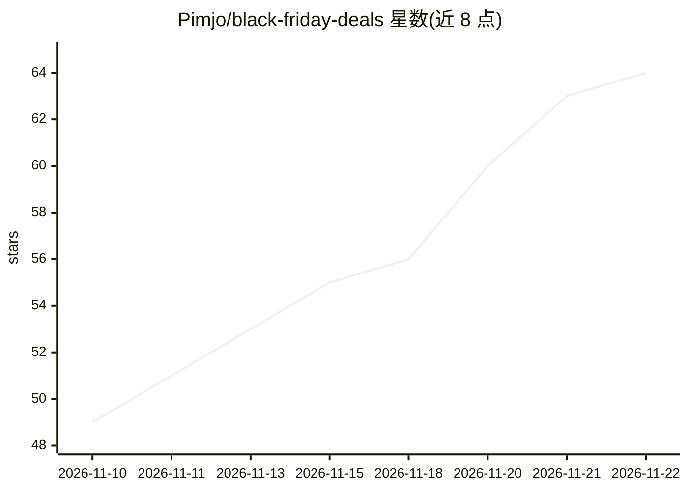

# Pimjo/black-friday-deals

⭐ 64 · 推送 2026-11-20 · [GitHub](https://github.com/Pimjo/black-friday-deals) · [官网](https://pimjo.com/black-friday-cyber-monday-deal) · 个人维护

**面向开发者与设计师的黑五促销清单：161+ 条工具折扣**

由社区与厂商提交、经审核后发布的 Black Friday/Cyber Monday 2026 折扣聚合清单，收录 161+ 条交易，按 AI 工具、UI 套件与模板、开发工具与 SaaS、设计与图标、托管、营销 SEO、效率应用、书籍课程、NoCode 等类别组织。每条包含产品描述、折扣详情、优惠码与有效期；使用者通过产品链接结账时输入优惠码兑换。覆盖对象多为商业 SaaS 与付费产品，非本仓库自身安装的软件。

## 筛选速览

| 维度 | 判定 | 备注 |
|---|---|---|
| AI 角色 | `ai-knowledge` | 知识聚合/清单类 |
| 许可风险 | `none` | — |
| 部署形态 | `None` |  |
| 模型依赖 | — | README 未给出锁定关系 |
| 硬件要求 | — | 无带数字的原话,不猜 |
| 安装摩擦 | `low` | 无编译、无系统依赖或容器化 |
| 成熟度 | — | 结构信号不足 |

## 能力要点

- 161+ 条经审核的折扣条目，含优惠码与有效期
- 按 AI 工具、UI 模板、Dev Tools 等 11+ 类别组织
- 支持厂商与社区通过提交方式收录新交易

## 适用场景

- 黑五期间集中查找 AI 工具与 SaaS 的优惠码
- 比较开发者与设计师资源的折扣力度和有效期
- 产品厂商提交自己的促销活动获得曝光

## 场景标签

`精选清单` · 领域:学习与行业

## 证据(README 行号)

> L1: # Best Black Friday Deals 2026 - AI Tools, SaaS, Apps, Developer-Designer Tools and More
> L5: Deals are **submitted by makers and the community and reviewed** before they go live, with the coupon code and dates
> L7: > **Total Deals Count**: 161+ · Have a deal? Add it here
> L9: **Jump to:** 🤖 AI Tools · 🎨 UI Kits & Templates · 🛠️ Dev Tools & SaaS · 🖋️ Design & Icons · 🌐 Hosting · 📈 Marketing 

## 星数曲线

2026-11-10 49 → 2026-11-22 64（+15）

---
*卡片 v1 · prompt 1.4 · 生成 2026-11-18 · 置信度 high · 依据 README sha `a467a3a69ba9` · [字段定义](../../DATASET.md)*
