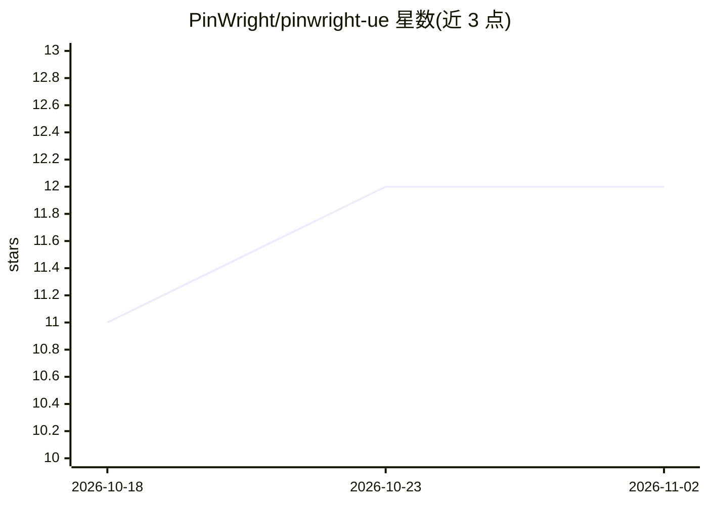

# PinWright/pinwright-ue

⭐ 12 · C++ · MIT · 推送 2026-10-21 · [GitHub](https://github.com/PinWright/pinwright-ue) · [官网](https://pinwright.com) · 组织维护

**Unreal 编辑器内的 MCP 服务器，让 AI 编程代理操作编辑器**

Unreal Engine 编辑器插件，在本地回环端口运行 MCP 服务器，把已有的 AI 编程助手（Claude Code、Codex、Cursor、Gemini CLI、VS Code Copilot 等 MCP 客户端）接入编辑器：代理可构建/编辑 Blueprint、编写 UMG 界面、生成静态网格与动画、搭建关卡、运行 Play-In-Editor 复现并修复 bug。共 1,309 个操作、68 个命名空间，针对 5,839 个自动化测试开发。无需自身订阅或 API key，走用户已有的 AI 计划。安装方式：Releases 预编译 zip（Windows）、Epic Fab、或克隆仓库自行构建（Windows/Linux）。

## 筛选速览

| 维度 | 判定 | 备注 |
|---|---|---|
| AI 角色 | `ai-ecosystem` | LLM/agent 周边工具 |
| 许可风险 | `permissive` | MIT |
| 部署形态 | `None` |  |
| 模型依赖 | — | README 未给出锁定关系 |
| 硬件要求 | — | 无带数字的原话,不猜 |
| 安装摩擦 | `low` | 无编译、无系统依赖或容器化 |
| 成熟度 | — | 结构信号不足 |

## 能力要点

- 68 个命名空间共 1,309 个操作，覆盖资产、Blueprint、UMG、关卡、材质与 Niagara
- 代理可运行 Play-In-Editor、发送输入、读取实时状态与日志以复现修复 bug
- 文本配方生成静态网格、骨骼与动画资产
- 一键为各代理写入项目本地 MCP 配置

## 适用场景

- 用自然语言让编程助手在 Unreal 编辑器里搭 UI、建关卡、写 Blueprint
- 让代理复现并修复游戏 bug 后重编译验证
- 把项目资产 dump 为文本供代理检索与批量修改

## 场景标签

`编码 Agent` · 领域:编码与开发

## 证据(README 行号)

> L3: **Describe what you want in plain language and your AI coding assistant does it in the Unreal Editor:** builds Bluep
> L47: An editor-only Unreal Engine plugin that speaks MCP (Model Context Protocol) on a loopback port. The assistant read

## 星数曲线

2026-10-18 11 → 2026-11-02 12（+1）

---
*卡片 v1 · prompt 1.4 · 生成 2026-11-01 · 置信度 high · 依据 README sha `5ac5738cf578` · [字段定义](../../DATASET.md)*
