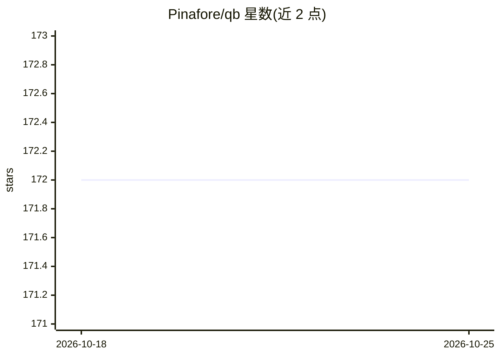

# Pinafore/qb

⭐ 172 · Python · MIT · 推送 2025-12-08 · [GitHub](https://github.com/Pinafore/qb) · 组织维护

**Quiz Bowl 问答 AI 系统：含数据集与答案预测模型**

QANTA 是问答竞赛（Quiz Bowl）AI 系统，同时发布配套数据集：含未映射/已映射 Wikipedia 答案的多版本题目 JSON 与 sqlite3 格式，以及训练/开发/测试划分。系统通过 YAML 配置启用多个 guesser（TFIDF、DAN、RNN、ElasticSearch 等），用 Luigi 数据管道执行下载、预处理（Wikipedia 转储解析、重定向与消歧页过滤需 MySQL）、训练与性能报告，支持 AWS S3 检查点。数据预处理依赖 Apache Spark、AWS CLI 与 lz4，Python 3.6 环境。

## 筛选速览

| 维度 | 判定 | 备注 |
|---|---|---|
| AI 角色 | `ai-native` | 本体是模型或模型工具 |
| 许可风险 | `permissive` | MIT |
| 部署形态 | `library` | 以包/库形式分发 |
| 模型依赖 | — | README 未给出锁定关系 |
| 硬件要求 | — | 无带数字的原话,不猜 |
| 安装摩擦 | `low` | 无编译、无系统依赖或容器化 |
| 成熟度 | — | 结构信号不足 |

## 能力要点

- 多版本 Quiz Bowl 数据集（JSON/sqlite3，含 Wikipedia 答案映射与训练划分）
- 可配置启用的多种 guesser（TFIDF/DAN/RNN/ElasticSearch）
- Luigi 管道管理下载、预处理、训练与报告全流程
- AWS S3 运行版本检查点与恢复脚本

## 适用场景

- 获取带 Wikipedia 答案映射的 Quiz Bowl 问答数据集做研究
- 训练与评测答题猜测模型并生成性能报告
- 基于 Wikipedia 转储构建实体消歧与重定向数据

## 场景标签

 · 领域:自然语言处理/问答

## 证据(README 行号)

> L20: * `qanta.unmapped.2018.04.18.json`: All questions in our dataset, without mapped Wikipedia answers. Sourced from
> L78: `qanta.guesser.tfidf.TfidfGuesser`. If you are looking for our best model and

## 星数曲线

2026-10-18 172 → 2026-10-25 172（+0）

---
*卡片 v1 · prompt 1.4 · 生成 2026-10-22 · 置信度 mid · 依据 README sha `a8ce6d1c03ce` · [字段定义](../../DATASET.md)*
