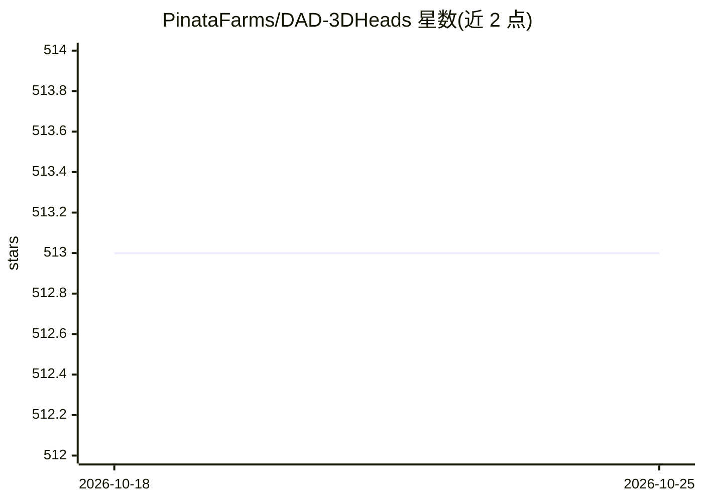

# PinataFarms/DAD-3DHeads

⭐ 513 · Python · NOASSERTION · 推送 2026-01-23 · [GitHub](https://github.com/PinataFarms/DAD-3DHeads) · 组织维护

**CVPR 2022 论文官方仓库：单图 3D 头部对齐数据集与训练代码**

DAD-3DHeads 论文（CVPR 2022）的官方仓库，提供大规模 3D 头部对齐数据集（2026 年起上架 Hugging Face）及配套 PyTorch 训练与评测代码：数据集需下载解压到 dataset 目录，训练基于 hydra 配置（.yaml），支持可视化 68/191/445 个 2D 人脸关键点、face/head mesh、头部姿态等；另含 benchmark 评测协议目录与 demo 脚本，后续版本新增 UV 纹理预测器与 PNCC 估计器。代码要求 Python 3.8，数据集与代码按 CC BY-NC-SA 4.0 提供。

## 筛选速览

| 维度 | 判定 | 备注 |
|---|---|---|
| AI 角色 | `ai-knowledge` | 知识聚合/清单类 |
| 许可风险 | `none` | NOASSERTION |
| 部署形态 | `library` | 以包/库形式分发 |
| 模型依赖 | — | README 未给出锁定关系 |
| 硬件要求 | — | 无带数字的原话,不猜 |
| 安装摩擦 | `low` | 无编译、无系统依赖或容器化 |
| 成熟度 | — | 结构信号不足 |

## 能力要点

- 大规模 3D 头部对齐数据集，已上架 Hugging Face
- 基于 hydra 配置的训练代码与 benchmark 评测协议
- demo 支持输出 68/191/445 关键点、face/head mesh、头部姿态等
- 2024 年新增 UV 纹理预测器与 PNCC 估计器

## 适用场景

- 3D 人脸/头部对齐与重建模型的训练
- 在 DAD-3DHeads benchmark 上评测头部对齐方法
- 对单张输入图像运行 3D 头部关键点与 mesh 预测 demo

## 场景标签

`模型评测` `图像视频处理` · 领域:评测与运维

## 证据(README 行号)

> L1: # DAD-3DHeads: A Large-scale Dense, Accurate and Diverse Dataset for 3D Head Alignment from a Single Image
> L49: First, you need to download the DAD-3DHeads dataset and extract it to the `dataset/DAD-3DHeadsDataset` directory.

## 星数曲线

2026-10-18 513 → 2026-10-25 513（+0）

---
*卡片 v1 · prompt 1.4 · 生成 2026-10-21 · 置信度 low · 依据 README sha `02b1598201a2` · [字段定义](../../DATASET.md)*
