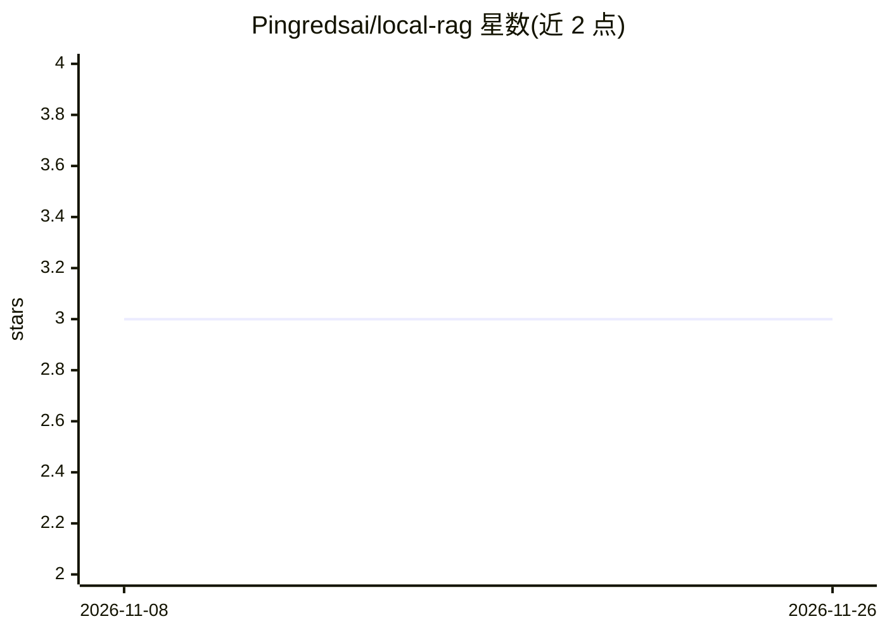

# Pingredsai/local-rag

⭐ 3 · Python · MIT · 推送 2026-10-28 · [GitHub](https://github.com/Pingredsai/local-rag) · 个人维护 · 中文 README

**自托管本地知识库：从自有文档回答问题且不出内网**

由 FastAPI 后端、Qdrant 向量库和 Ollama 运行时三个容器组成的文档问答系统：上传 PDF/DOCX/TXT/Markdown 后自动解析、分块、用 bge-m3 嵌并入 Qdrant，查询时检索 Top-K 片段、由本地 LLM（默认 qwen2.5:3b）生成带来源引用的回答，运行时不调用外部 AI API、无遥测。提供 REST API 与静态 Web UI，支持 Docker Compose 部署与离线（air-gapped）部署，另有免 Docker 的 Windows 桌面包 beta。当前限制：仅支持文本型 PDF、单知识库、无认证与多租户。

## 筛选速览

| 维度 | 判定 | 备注 |
|---|---|---|
| AI 角色 | `ai-native` | 本体是模型或模型工具 |
| 许可风险 | `permissive` | MIT |
| 部署形态 | `desktop` | 安装包/桌面程序 |
| 模型依赖 | local-ok | 支持本地模型 |
| 硬件要求 | — | 无带数字的原话,不猜 |
| 安装摩擦 | `low` | 无编译、无系统依赖或容器化 |
| 成熟度 | `idea` | |

## 能力要点

- 文档上传后自动解析、分块、嵌入并索引，回答附带来源引用
- 完全本地运行：运行时不调用外部 AI API、无遥测，支持离线部署
- REST API 覆盖上传、索引列表、删除、流式/非流式问答
- 按硬件给出模型建议（CPU 笔记本到 48GB+ VRAM 对应 qwen2.5 不同规格）

## 适用场景

- 在律所/医院/金融等场景对敏感文档做内部问答
- 无外网的内网（air-gapped）环境部署文档检索问答
- 团队自托管知识库，替代把内部文档发给云端 AI 服务

## 场景标签

`文档问答` · 领域:知识与检索

## 证据(README 行号)

> L9: LocalRAG runs entirely inside your infrastructure. Documents, embeddings, retrieval, and answer generation stay on y
> L33: - Generate answers from retrieved document context.
> L46: |**FastAPI backend**|Document processing, RAG orchestration, REST API, static web UI|

## 星数曲线

2026-11-08 3 → 2026-11-26 3（+0）

---
*卡片 v1 · prompt 1.4 · 生成 2026-11-22 · 置信度 high · 依据 README sha `f5f0f8d7244c` · [字段定义](../../DATASET.md)*
