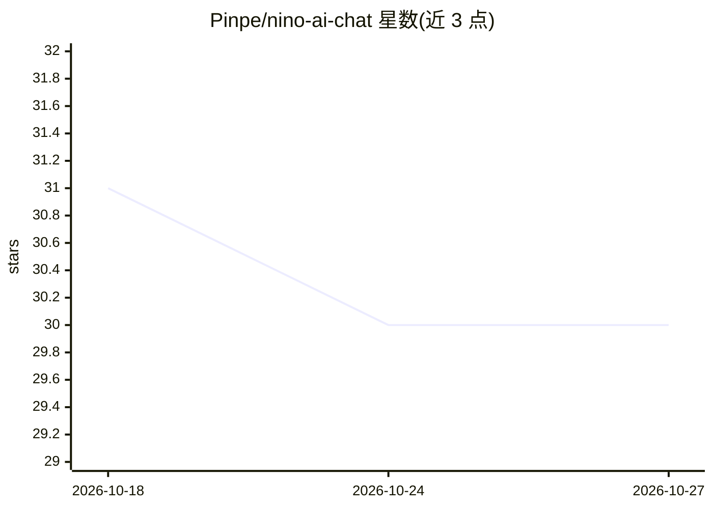

# Pinpe/nino-ai-chat

⭐ 30 · HTML · GPL-3.0 · 推送 2026-01-11 · [GitHub](https://github.com/Pinpe/nino-ai-chat) · [官网](https://pinpe.top) · 个人维护 · 中文 README

**面向陪伴聊天的本地存储 AI 聊天应用**

基于 Python/Flask 的开源 AI 聊天软件，面向终端用户，主打陪伴对话：以可爱口语化语气交流，支持长期记忆（自动记录偏好与约定并可手动管理），结合时间、天气等环境因素生成个性化回复。模型侧调用 Deepseek API（可切换 reasoner/chat），图片识别用阿里云百炼，天气用心知天气。所有聊天记录、记忆与配置以 JSON 文件存储在本地。提供 Python 源码部署与 Docker 两种方式，GPL-3.0 协议。

## 筛选速览

| 维度 | 判定 | 备注 |
|---|---|---|
| AI 角色 | `ai-native` | 本体是模型或模型工具 |
| 许可风险 | `viral` | GPL-3.0 |
| 部署形态 | `self-host` | docker 或自建部署 |
| 模型依赖 | locked-api |  |
| 硬件要求 | — | 无带数字的原话,不猜 |
| 安装摩擦 | `low` | 无编译、无系统依赖或容器化 |
| 成熟度 | — | 结构信号不足 |

## 能力要点

- 长期记忆能力，自动记录个人信息与约定，支持手动管理
- 结合时间/天气/温度与上下文生成个性化回复
- 所有数据本地 JSON 存储，仅必要时调用第三方 API
- 支持切换 Deepseek reasoner/chat 模型、开启/关闭记忆功能

## 适用场景

- 日常陪伴聊天与心理调适
- 桌面或移动端浏览器中私有部署个人 AI 陪伴应用
- 需要记忆用户偏好的长期对话场景

## 场景标签

`聊天机器人` · 领域:对话与助手

## 证据(README 行号)

> L4: Nino是一款轻量级、开源的AI聊天软件，专注于陪伴与理解用户。它能记住你的偏好、习惯和重要信息，结合时间、天气等环境因素，用可爱温柔的语气与你互动，可用于日常聊天、心理调适等场景。所有数据均存储在本地，隐私安全有保障～
> L9: - **个性化回复**：结合当前时间、天气、温度和聊天上下文生成专属回应

## 星数曲线

2026-10-18 31 → 2026-10-27 30（-1）

---
*卡片 v1 · prompt 1.4 · 生成 2026-10-26 · 置信度 mid · 依据 README sha `eaedf499e375` · [字段定义](../../DATASET.md)*
