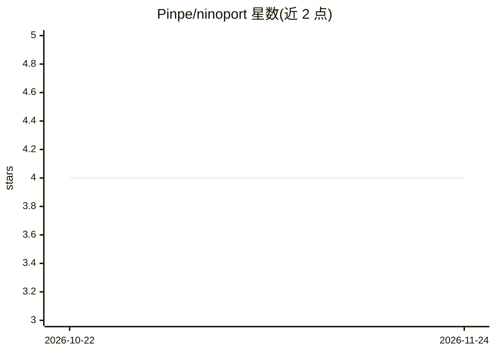

# Pinpe/ninoport

⭐ — · [GitHub]() · 个人维护 · 中文 README

**本地 API 网关面板：统一管理各家 AI Key 并直接对话**

运行在本机的 Flask Web 面板，把散落各处的 AI 接口组织成「实例」（Key＋模型＋开关），点开即聊。支持 Chat Completions、OpenAI Responses、Anthropic Messages 三种协议，差异在协议层消化；提供思考强度参数、等效调用代码预览、测试连接、上下文导出导入、/agent 无浏览器调用路由。配置与历史只存本机 JSON 文件，Key 明文保存、无账号与权限系统，官方提示不要暴露公网。Windows 提供免 Python 的打包版，其余平台从源码运行。

## 筛选速览

| 维度 | 判定 | 备注 |
|---|---|---|
| AI 角色 | `ai-ecosystem` | LLM/agent 周边工具 |
| 许可风险 | `viral` | — |
| 部署形态 | `desktop` | 安装包/桌面程序 |
| 模型依赖 | — | README 未给出锁定关系 |
| 硬件要求 | — | 无带数字的原话,不猜 |
| 安装摩擦 | `low` | 无编译、无系统依赖或容器化 |
| 成熟度 | — | 结构信号不足 |

## 能力要点

- 三种 API 协议（Chat Completions / OpenAI Responses / Anthropic Messages）统一接入
- /agent 路由可用 curl 直接对实例发消息、读上下文
- 实例配置与对话历史仅存本机 JSON，不上传
- 创建实例时实时生成等效调用代码并可一键测试连接

## 适用场景

- 集中管理多个中转站和官方 API 的 Key，免得每次翻文档写 curl
- 本地调试不同协议模型的思考参数与上下文行为
- 给脚本或 Agent 提供 /agent 路由的非浏览器调用入口

## 场景标签

`模型网关` `聊天机器人` · 领域:Agent 开发

## 证据(README 行号)

> L3: NinoPort 是一个跑在自己电脑上的小面板，用来管那些散在各处的 AI 接口。
> L15: - **多协议**：一个实例可以选择走 `Chat Completions`、`OpenAI Responses API` 还是 `Anthropic Messages API`，各家的差异在 `lib/base_api.py` 
> L31: 1. **`main.py`** —— 只管 Flask 那点事：收表单、拼配置、存盘、跳页面。它不碰任何 API 细节。

## 星数曲线

2026-10-22 4 → 2026-11-24 4（+0）

---
*卡片 v1 · prompt 1.4 · 生成 2026-11-21 · 置信度 high · 依据 README sha `9084d3a59074` · [字段定义](../../DATASET.md)*
