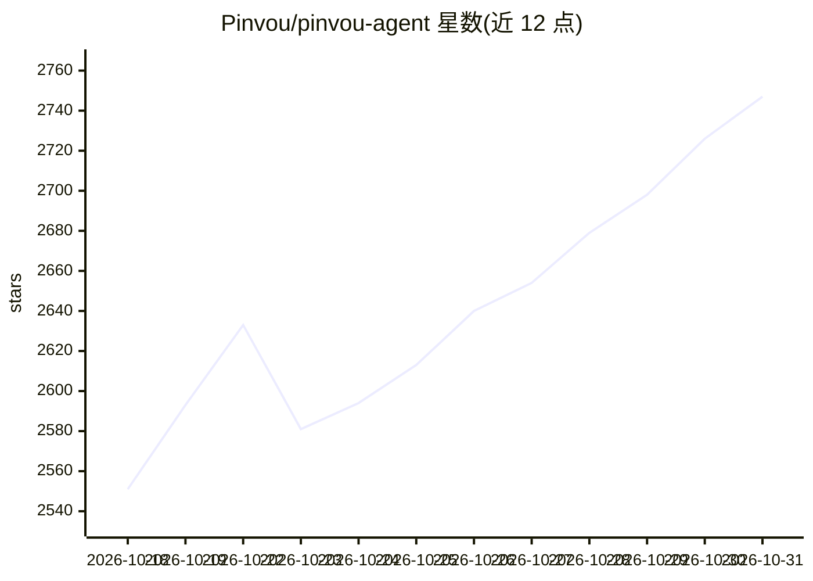

# Pinvou/pinvou-agent

⭐ 2,747 · Rust · MIT · 推送 2026-10-30 · [GitHub](https://github.com/Pinvou/pinvou-agent) · [官网](https://pinvou.com/) · 组织维护 · 中文 README

**开源桌面 AI agent 工作台：工作、设计与编码一体化交付**

基于 Tauri 2 + React/Vite + Rust 的桌面 AI agent 应用，提供 Work、Design、Code 三种模式：结合附件、本地知识库、MCP 工具与工作流交付文件成果；用自然语言生成海报/数据可视化并可在设计模式中继续编辑；通过 ACP 接入 Codex、Claude Code 或 Kimi 在真实项目中执行编码。模型接入支持本地 vLLM 与任意 OpenAI 兼容端点，数据默认存放于 ~/.pinvou3/。从源码运行需 Git 子模块、Node.js、Rust 工具链与 Tauri 2 系统依赖。

## 筛选速览

| 维度 | 判定 | 备注 |
|---|---|---|
| AI 角色 | `ai-native` | 本体是模型或模型工具 |
| 许可风险 | `permissive` | MIT |
| 部署形态 | `None` |  |
| 模型依赖 | local-ok | 支持本地模型 |
| 硬件要求 | — | 无带数字的原话,不猜 |
| 安装摩擦 | `low` | 无编译、无系统依赖或容器化 |
| 成熟度 | `idea` | |

## 能力要点

- Work/Design/Code 三模式桌面工作台，任务以交付文件而非聊天回复结束
- 本地知识库（全文+向量检索）、记忆中心、Persona 卡池与 Skills/工作流
- 通过 ACP 接入 Codex、Claude Code、Kimi 等编码 agent 操作真实项目
- 统一工具商店支持本地/远程 MCP 服务器、CLI 工具与 API 连接器，含飞书/钉钉/企微等预置连接器

## 适用场景

- 让 AI agent 完成研究、写作并交付可复用的文件成果
- 用自然语言生成海报与数据可视化并继续编辑
- 在桌面工作台内让编码 agent 直接修改我的真实项目
- 用本地模型与本地工具搭建完全离线的私有 agent 流程

## 场景标签

`编码 Agent` `AI 助手` `图像生成` · 领域:编码与开发

## 证据(README 行号)

> L23: Pinvou Agent is more than a chat window. It brings everyday work, visual design, and software development into one 
> L39: Use **Codex, Claude Code, or Kimi** through ACP in the same desktop workspace. The coding agent can read and edit a

## 星数曲线

2026-10-18 2,551 → 2026-10-31 2,747（+196）

---
*卡片 v1 · prompt 1.4 · 生成 2026-10-21 · 置信度 high · 依据 README sha `d9c21c51da0d` · [字段定义](../../DATASET.md)*
