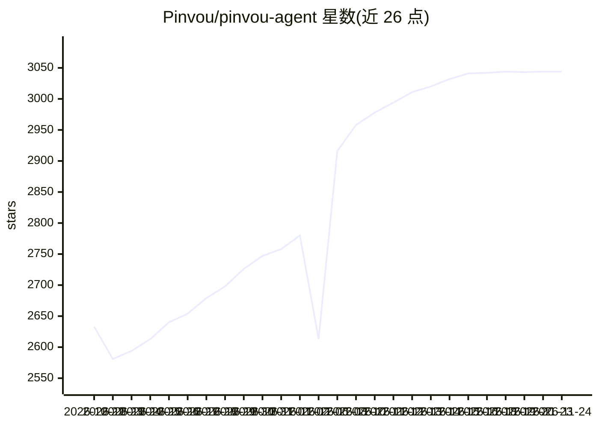

# Pinvou/pinvou-agent

⭐ 3,045 · Rust · MIT · 推送 2026-11-23 · [GitHub](https://github.com/Pinvou/pinvou-agent) · [官网](https://pinvou.com/) · 组织维护 · 中文 README

**面向工作、设计与编程的开源桌面 AI Agent 工作区**

基于 Tauri 2 + React 的桌面 AI Agent 应用，将日常工作、视觉设计与软件开发整合到一个工作区：任务以可交付文件结尾而非仅对话。支持本地知识库（全文与向量检索）、记忆中心、MCP 服务器与 CLI 连接器扩展，通过 ACP 接入 Codex、Claude Code、Kimi 等编码 Agent；模型接入本地 vLLM 或任意 OpenAI 兼容 API。提供 Plan/YOLO 两种执行模式、手机扫码远程控制、本地语音输入与 GPU/内存监控。源码运行需 Git、Node.js、npm 与 Rust 工具链。

## 筛选速览

| 维度 | 判定 | 备注 |
|---|---|---|
| AI 角色 | `ai-native` | 本体是模型或模型工具 |
| 许可风险 | `permissive` | MIT |
| 部署形态 | `None` |  |
| 模型依赖 | local-ok | 支持本地模型 |
| 硬件要求 | — | 无带数字的原话,不猜 |
| 安装摩擦 | `low` | 无编译、无系统依赖或容器化 |
| 成熟度 | — | 结构信号不足 |

## 能力要点

- Work/Design/Code 三种模式：任务产出可编辑工件、海报与数据可视化
- 本地知识库支持全文与向量检索，附记忆中心与角色卡池
- 统一工具商店：本地/远程 MCP 服务器、CLI 工具与 API 连接器（飞书、钉钉等）
- 经 ACP 接入 Codex、Claude Code、Kimi 编码 Agent

## 适用场景

- 让 Agent 完成研究、分析、写作并交付可复用文件
- 用自然语言生成海报与数据可视化并继续编辑
- 在桌面工作区中让编码 Agent 操作真实项目
- 用本地模型搭建完全私有的 Agent 循环

## 场景标签

`AI 助手` `编码 Agent` `RAG` · 领域:编码与开发

## 证据(README 行号)

> L5: **An open-source desktop AI agent workspace for work, design, and coding.**
> L23: Pinvou Agent is more than a chat window. It brings everyday work, visual design, and software development into one 
> L94: Pinvou Agent works with **local vLLM** and any **OpenAI-compatible API**. Save multiple model configurations in the

## 星数曲线

2026-10-22 2,633 → 2026-11-24 3,044（+411）

---
*卡片 v1 · prompt 1.4 · 生成 2026-11-23 · 置信度 high · 依据 README sha `6309e121f8e3` · [字段定义](../../DATASET.md)*
