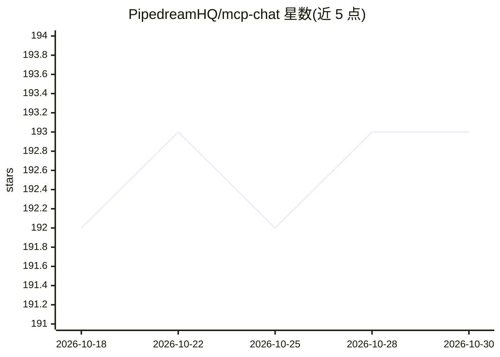

# PipedreamHQ/mcp-chat

⭐ 193 · TypeScript · NOASSERTION · 推送 2026-05-08 · [GitHub](https://github.com/PipedreamHQ/mcp-chat) · [官网](https://pipedream.com/docs/connect/mcp/developers) · 组织维护

**基于 Pipedream MCP 的开源 AI 聊天参考应用**

Pipedream 构建的开源聊天应用示例，基于 Vercel AI SDK 与 Pipedream MCP server，后者提供对近 3,000 个 API、10,000+ 工具的带内置鉴权的访问；聊天中自动发现并执行跨 API 的工具调用。演示应用使用 Anthropic、OpenAI、Gemini 模型，可换用任意 LLM 提供商。持久化用 Neon Serverless Postgres，登录用 Auth.js。可作为构建 AI 聊天应用的参考实现，支持 Vercel 一键部署或 pnpm 本地运行。

## 筛选速览

| 维度 | 判定 | 备注 |
|---|---|---|
| AI 角色 | `ai-native` | 本体是模型或模型工具 |
| 许可风险 | `none` | NOASSERTION |
| 部署形态 | `self-host` | docker 或自建部署 |
| 模型依赖 | — | README 未给出锁定关系 |
| 硬件要求 | — | 无带数字的原话,不猜 |
| 安装摩擦 | `low` | 无编译、无系统依赖或容器化 |
| 成熟度 | — | 结构信号不足 |

## 能力要点

- 通过 Pipedream MCP 连接近 3,000 个 API 与 10,000+ 工具，内置鉴权
- 聊天中自动发现并执行跨 API 的工具调用
- 基于 AI SDK，支持任意 LLM 提供商或框架
- Vercel 一键部署，本地运行可用 docker compose 启动 Postgres

## 适用场景

- 参考其代码构建带 MCP 工具调用的 AI 聊天应用
- 让聊天应用通过自然语言访问数千个 API
- 学习 MCP 与 AI SDK 的集成方式

## 场景标签

`聊天机器人` · 领域:对话与助手

## 证据(README 行号)

> L6:  MCP Chat is a free, open-source chat app built using the AI SDK, and Pipedream MCP, which provides access to nearly
> L18: - **MCP integrations**: Connect to thousands of APIs through Pipedream's MCP server with built-in auth
> L20: - **Uses the AI SDK**: Unified API for generating text, structured objects, and tool calls with LLMs

## 星数曲线

2026-10-18 192 → 2026-10-30 193（+1）

---
*卡片 v1 · prompt 1.4 · 生成 2026-10-22 · 置信度 high · 依据 README sha `6b11c388c1d3` · [字段定义](../../DATASET.md)*
