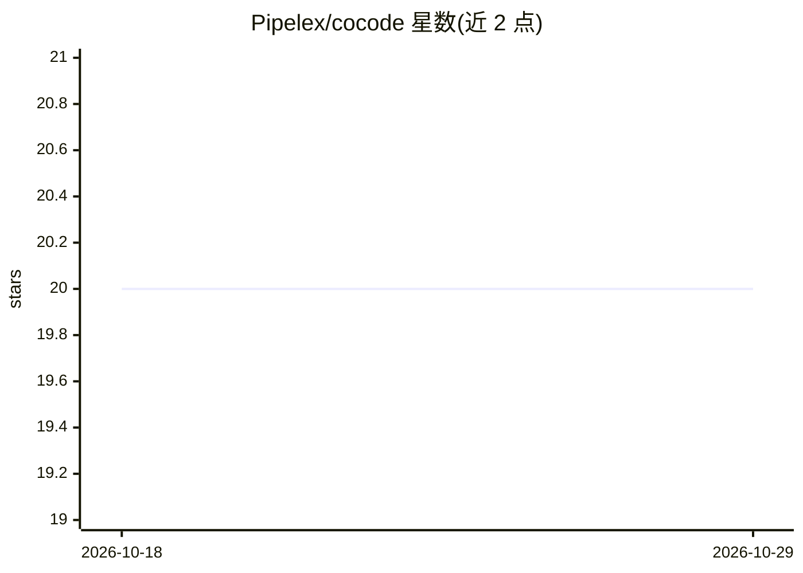

# Pipelex/cocode

⭐ 20 · Python · MIT · 推送 2026-10-23 · [GitHub](https://github.com/Pipelex/cocode) · [官网](https://pypi.org/project/cocode/) · 组织维护

**将代码仓库转为文本并用 AI 流水线做文档与分析的 CLI**

Cocode 是 Python 编写的命令行工具，基于 Pipelex 框架运行 AI 工作流：把仓库结构与内容转换为多种文本格式（Repo Map/Flat/Tree/Import List），支持 Python 接口/导入/完整源码三种抽取模式；主要 AI 功能包括从 git diff 生成 changelog、自动更新文档、文档校对与代码分析。模型接入可通过免费 Pipelex API key、自备 Anthropic/Bedrock/Google 凭证或本地 Ollama/vLLM/OpenAI 兼容端点。README 自述处于早期开发阶段，当前版本需在 cocode 目录内运行。

## 筛选速览

| 维度 | 判定 | 备注 |
|---|---|---|
| AI 角色 | `ai-ecosystem` | LLM/agent 周边工具 |
| 许可风险 | `permissive` | MIT |
| 部署形态 | `library` | 以包/库形式分发 |
| 模型依赖 | local-ok | 支持本地模型 |
| 硬件要求 | — | 无带数字的原话,不猜 |
| 安装摩擦 | `low` | 无编译、无系统依赖或容器化 |
| 成熟度 | `idea` | |

## 能力要点

- 仓库转文本多格式输出（Repo Map/Flat/Tree/Import List）
- 从 git diff 与版本对比生成 changelog 并自动更新文档
- Python 三种抽取模式：接口签名、导入依赖、完整源码
- 支持 Claude/Gemini、Bedrock 及本地 Ollama/vLLM 端点

## 适用场景

- 发版时自动生成 changelog 并同步更新 README/文档
- 把整个代码库转成文本供 AI 处理或生成入门文档
- 检查文档与代码之间的不一致之处
- 分析 git diff 回答架构变化问题

## 场景标签

`AI 写作` · 领域:内容生成

## 证据(README 行号)

> L5: Cocode is a powerful command-line tool for analyzing and processing code repositories. It converts repository struct
> L170: Cocode integrates with the Pipelex framework for AI pipeline processing. Configuration files control default setti

## 星数曲线

2026-10-18 20 → 2026-10-29 20（+0）

---
*卡片 v1 · prompt 1.4 · 生成 2026-10-28 · 置信度 high · 依据 README sha `c75540dc3c08` · [字段定义](../../DATASET.md)*
