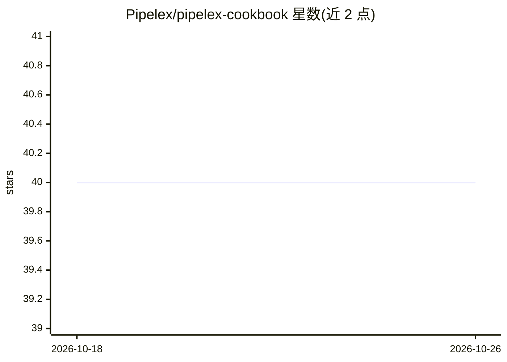

# Pipelex/pipelex-cookbook

⭐ 40 · Python · MIT · 推送 2026-10-23 · [GitHub](https://github.com/Pipelex/pipelex-cookbook) · [官网](https://pipelex.com) · 组织维护

**用 MTHDS 语言编写、经 Pipelex 运行的 AI 方法示例集**

Pipelex 官方 Cookbook：收录用 MTHDS 语言编写、可在 Pipelex 托管 API 上按地址运行的 AI 方法示例，覆盖文档问答、发票抽取、图像生成、CV 筛选、表格抽取、推文优化等十余个方法与多篇食谱式教程。运行途径包括聊天机器人中添加 Pipelex MCP、Claude Code/Codex 插件、Python/TypeScript SDK、HTTP API、终端 pipelex 命令及 method-app 脚手架；需注册 Pipelex 账号，每次运行消耗账户额度，无需自带模型供应商 key。示例供阅读、运行与改编。

## 筛选速览

| 维度 | 判定 | 备注 |
|---|---|---|
| AI 角色 | `ai-knowledge` | 知识聚合/清单类 |
| 许可风险 | `permissive` | MIT |
| 部署形态 | `library` | 以包/库形式分发 |
| 模型依赖 | — | README 未给出锁定关系 |
| 硬件要求 | — | 无带数字的原话,不猜 |
| 安装摩擦 | `low` | 无编译、无系统依赖或容器化 |
| 成熟度 | — | 结构信号不足 |

## 能力要点

- 十余个按地址运行的 AI 方法示例（文档问答、发票抽取、图像生成等）
- 同一方法可经 MCP、编码 agent 插件、SDK、HTTP API、终端多种途径运行
- 教程覆盖 MTHDS 语言：从管道到结构化输出、批处理与并行步骤
- `npm create @pipelex/method-app` 从方法生成可运行 web 应用

## 适用场景

- 学习并改编现成 AI 方法用于文档处理或内容生成
- 在 Claude Code/Codex 或聊天机器人中直接调用这些方法
- 把某个方法快速包成 Web 应用或集成进自己的代码

## 场景标签

`文档问答` `图像生成` `教程课程` · 领域:内容生成

## 证据(README 行号)

> L4:  Worked examples of AI methods, written in MTHDS and run with Pipelex, to read, run and adapt.
> L92: More methods are published in the Pipelex method library, and each runs by its address the same way, through every 

## 星数曲线

2026-10-18 40 → 2026-10-26 40（+0）

---
*卡片 v1 · prompt 1.4 · 生成 2026-10-25 · 置信度 mid · 依据 README sha `c1d36dd5c8c5` · [字段定义](../../DATASET.md)*
