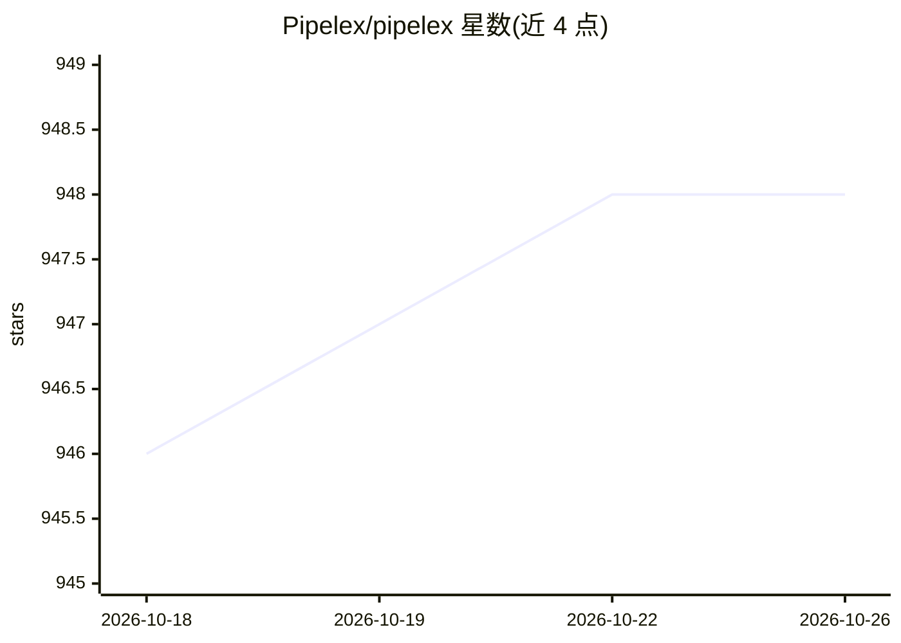

# Pipelex/pipelex

⭐ 948 · Python · NOASSERTION · 推送 2026-10-25 · [GitHub](https://github.com/Pipelex/pipelex) · [官网](https://pipelex.com) · 组织维护

**用编码 agent 构建 AI 方法并以 MCP/Webapp/API 运行的运行时**

Pipelex 是一个 Python 运行时与配套体系：用户用自然语言描述工作流程，编码 agent（Claude Code/Codex）通过插件生成以 MTHDS 语言编写的 .mthds 文件——一种类型化、多步骤的确定性 AI 过程，可串联 LLM、OCR、图像生成等。同一方法可通过 CLI、Python/TypeScript SDK、REST API、MCP、n8n 等多种目标执行；运行时可自托管或使用托管 API，支持多家模型提供商及本地模型。采用 Elastic License 2.0，插件部分需 Node.js。

## 筛选速览

| 维度 | 判定 | 备注 |
|---|---|---|
| AI 角色 | `ai-ecosystem` | LLM/agent 周边工具 |
| 许可风险 | `none` | NOASSERTION |
| 部署形态 | `library` | 以包/库形式分发 |
| 模型依赖 | local-ok | 支持本地模型 |
| 硬件要求 | — | 无带数字的原话,不猜 |
| 安装摩擦 | `medium` | 含编译或系统依赖之一 |
| 成熟度 | — | 结构信号不足 |

## 能力要点

- 以 MTHDS 开放标准描述多步 AI 方法，运行时负责模型路由、结构化输出解析与流水线编排
- 同一 .mthds 文件可在 CLI、Python、TypeScript、REST API、MCP、n8n 等目标运行
- 提供 Claude Code 与 Codex 插件，含技能、每次编辑的检查钩子与工具
- 支持托管 API、自带密钥的各家提供商及 Ollama/vLLM/LM Studio/llama.cpp 本地模型

## 适用场景

- 让编码 agent 把业务流程（如发票提取）构建为可复用的 AI 方法
- 把 AI 方法接入聊天机器人作为 MCP 工具调用
- 以 SDK 或 API 将 AI 方法集成进自己的软件

## 场景标签

`工作流自动化` `Agent 框架` · 领域:Agent 开发

## 证据(README 行号)

> L4:  Describe how the work gets done in plain English, and your coding agent builds it into a method with the Pipelex pl
> L75: This repository is the Pipelex runtime: the Python package that reads a `.mthds` file and runs it. Install it and r
> L176: The same `.mthds` file runs from multiple execution targets:

## 星数曲线

2026-10-18 946 → 2026-10-26 948（+2）

---
*卡片 v1 · prompt 1.4 · 生成 2026-10-21 · 置信度 high · 依据 README sha `19ae684c112c` · [字段定义](../../DATASET.md)*
