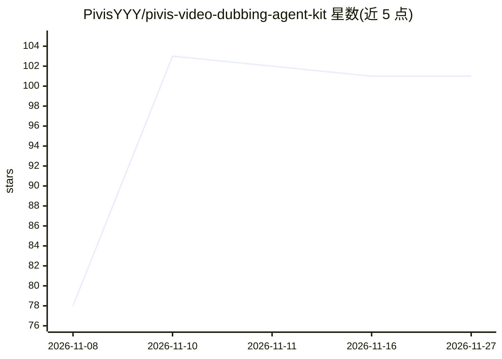

# PivisYYY/pivis-video-dubbing-agent-kit

⭐ 101 · Python · MIT · 推送 2026-11-04 · [GitHub](https://github.com/PivisYYY/pivis-video-dubbing-agent-kit) · 个人维护 · 中文 README

**供 Agent 操作的本地英文视频→中文译配管线（Apple Silicon）**

面向 Apple Silicon Mac 的英文视频中文译配工具包，设计为由 Hermes、Codex 等 Agent 按 AGENTS.md 指令操作现成代码执行。管线为：提取音轨→英文 ASR/词时间戳→翻译与语义审校→MLX TTS→时长门禁→独立 ASR 复核→中英双语字幕→混音渲染，最终需人工听审确认。语音走 MLX，文本翻译可用本地 Ollama 或显式授权的远程接口；仅支持单说话人源语音。仓库自述为预览版，公开 CLI 仅验证过 11.007 秒单句样片的机器检查，不承诺全自动交付质量。

## 筛选速览

| 维度 | 判定 | 备注 |
|---|---|---|
| AI 角色 | `ai-native` | 本体是模型或模型工具 |
| 许可风险 | `permissive` | MIT |
| 部署形态 | `None` |  |
| 模型依赖 | local-ok | 支持本地模型 |
| 硬件要求 | — | 无带数字的原话,不猜 |
| 安装摩擦 | `medium` | 含编译或系统依赖之一 |
| 成熟度 | `idea` | |

## 能力要点

- ASR→翻译→TTS→字幕→混音的分层管线，每阶段留有可审计中间产物与质量门禁
- 短样片机器检查通过并经人工批准后才能跑全片，程序核对批准样片哈希
- 语音使用 MLX 本地运行，文本模型可选本地 Ollama 或显式授权的远程接口
- 断点续跑与基于指纹的缓存复用，篡改 checkpoint 会触发完整性错误

## 适用场景

- 我想让 Agent 在本地把英文视频做成中文配音加中英字幕
- 在 Apple Silicon Mac 上不出网调用远程语音服务完成译配
- 通过短样片→人工听审→全片的流程控制译配质量

## 场景标签

`语音识别` `语音合成` · 领域:内容生成

## 证据(README 行号)

> L5: A local English-to-Chinese video dubbing pipeline operated by agents such as Hermes or Codex through existing code a
> L56: 输入视频 → 提取音轨 → 英文 ASR／词时间戳 → 语义句
> L58:         → 预置声线或授权参考音色 TTS → 时长门禁

## 星数曲线

2026-11-08 78 → 2026-11-27 101（+23）

---
*卡片 v1 · prompt 1.4 · 生成 2026-11-17 · 置信度 high · 依据 README sha `3cee49f98b0a` · [字段定义](../../DATASET.md)*
