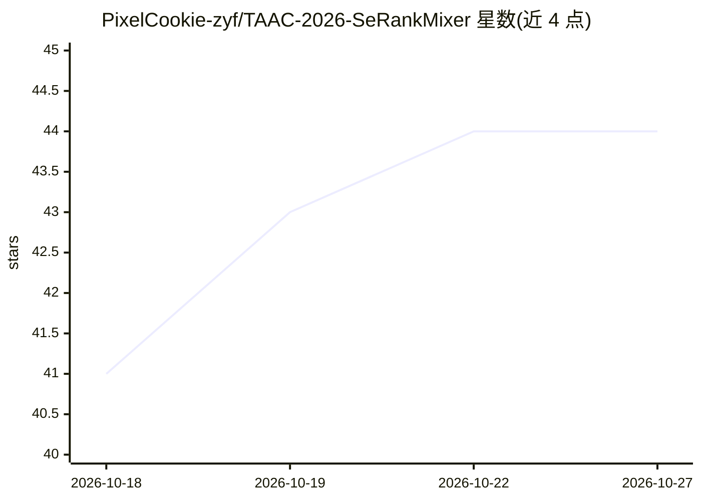

# PixelCookie-zyf/TAAC-2026-SeRankMixer

⭐ 44 · Python · MIT · 推送 2026-07-21 · [GitHub](https://github.com/PixelCookie-zyf/TAAC-2026-SeRankMixer) · 组织维护

**TAAC 2026 腾讯 UNI-REC 赛道单模型 pCVR 排序网络**

面向 TAAC 2026 / KDD Cup 2026 腾讯 UNI-REC 赛道的单模型（非集成）转化率预测排序方案：以语义分词的 RankMixer 为骨干，结合 DIN 目标注意力行为序列池化、Wide&Deep 浅层流与分组双线性融合，训练采用 Muon 优化器拆分、常数学习率 SWA 与 SAM。官方测试集加权 AUC 0.828814，排名第 9。要求 Python 3.9+ 与 PyTorch 2.x，数据为 Parquet 目录加 schema.json，多卡经 torchrun DDP 训练，附带论文。

## 筛选速览

| 维度 | 判定 | 备注 |
|---|---|---|
| AI 角色 | `ai-native` | 本体是模型或模型工具 |
| 许可风险 | `permissive` | MIT |
| 部署形态 | `library` | 以包/库形式分发 |
| 模型依赖 | — | README 未给出锁定关系 |
| 硬件要求 | — | 无带数字的原话,不猜 |
| 安装摩擦 | `low` | 无编译、无系统依赖或容器化 |
| 成熟度 | — | 结构信号不足 |

## 能力要点

- RankMixer 骨干 + 双流分组双线性融合 + DIN 行为序列建模
- Muon/AdamW/Adagrad 优化器拆分 + 常数 LR SWA + SAM 训练配方
- 单模型（无集成）测试加权 AUC 0.828814，排名第 9
- infer.py 从环境变量读取路径并输出 predictions.json

## 适用场景

- 复现竞赛排名方案或研究 CTR/CVR 排序模型结构
- 参考 Muon+SWA+SAM 训练配方用于工业推荐模型
- 基于 ablation 与 scaling 结果选择模型组件

## 场景标签

`推荐系统` · 领域:学习与行业

## 证据(README 行号)

> L5: A single-model (non-ensemble) **post-click conversion-rate (pCVR)** ranking network
> L11: > **Result:** official leaderboard test weighted-AUC **0.828814**, final rank **#9**,
> L72: On the official TAAC-2026 / KDD Cup 2026 Tencent UNI-REC test set, the model reaches a test

## 星数曲线

2026-10-18 41 → 2026-10-27 44（+3）

---
*卡片 v1 · prompt 1.4 · 生成 2026-10-25 · 置信度 high · 依据 README sha `21a9a1a90f5b` · [字段定义](../../DATASET.md)*
