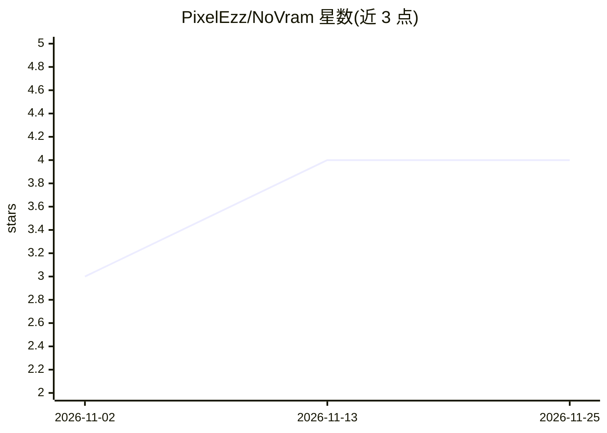

# PixelEzz/NoVram

⭐ 4 · Go · MIT · 推送 2026-11-02 · [GitHub](https://github.com/PixelEzz/NoVram) · [官网](https://github.com/PixelEzz/NoVram) · 个人维护

**给无独显低配电脑的纯 CPU 本地 LLM 运行器**

以单个 Go 编译二进制分发的 CPU 推理运行器，读取 GGUF 格式模型文件，在系统内存中运行并生成文本；内置 OpenAI 兼容的本地微型服务器（localhost:8080/v1），可接入 Cursor、Roo Code、Cline、Continue 等客户端。机制上采用物理核/逻辑核双相绑定、CPU Flash Attention、Q8_0 量化 KV cache、n-gram 投机解码与加载前零交换内存检查（novram doctor）。定位无独立显卡的 PC 与 VPS，无需 Python、PyTorch 或 CUDA。

## 筛选速览

| 维度 | 判定 | 备注 |
|---|---|---|
| AI 角色 | `ai-ecosystem` | LLM/agent 周边工具 |
| 许可风险 | `permissive` | MIT |
| 部署形态 | `None` |  |
| 模型依赖 | — | README 未给出锁定关系 |
| 硬件要求 | `cpu-ok` | |
| 安装摩擦 | `medium` | 含编译或系统依赖之一 |
| 成熟度 | — | 结构信号不足 |

## 能力要点

- 读取 GGUF 模型在系统 RAM 上运行，无需 GPU/CUDA/VRAM
- 内置 OpenAI 兼容微型服务器，可对接 Cursor/Cline/Continue
- n-gram 投机解码与物理核解码绑定加速
- novram doctor 检查 CPU 与内存可行性，零交换保证

## 适用场景

- 在没有独显的笔记本上本地跑小参数量 GGUF 模型
- 给 Cursor/Cline 等编码工具提供本地 OpenAI 兼容接口
- 在无 GPU 的 Linux VPS 或云实例上运行推理

## 场景标签

`推理引擎` · 领域:训练与推理

## 证据(README 行号)

> L12: **The Ultra-Fast, Zero-Dependency CPU Inference Engine & OpenAI-Compatible Micro-Server**
> L63: novram serve --model ./models/llama-3.2-3b.Q4_K_M.gguf --port 8080

## 星数曲线

2026-11-02 3 → 2026-11-25 4（+1）

---
*卡片 v1 · prompt 1.4 · 生成 2026-11-21 · 置信度 high · 依据 README sha `1b2ce82a0246` · [字段定义](../../DATASET.md)*
