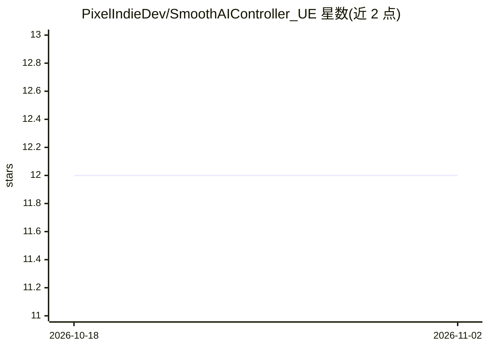

# PixelIndieDev/SmoothAIController_UE

⭐ 12 · C++ · MIT · 推送 2026-09-26 · [GitHub](https://github.com/PixelIndieDev/SmoothAIController_UE) · 个人维护

**虚幻引擎 AI 控制器：让 AI 角色平滑转向目标**

面向 Unreal Engine 5（可能兼容 UE4）的 C++ AIController 组件，替代引擎默认的 SetFocus/SetFocalPoint/ClearFocus 逻辑，将旋转改为随时间插值，实现平滑的偏航与俯仰转向，而非瞬间吸附。提供蓝图可编辑的插值速度、插值类型（Linear/EaseIn/EaseOut/EaseInOut/恒定角速度）、眼睛高度偏移与随机化设置；修复注视目标点时仅偏航旋转的问题。安装方式为复制 Public/Private 源码文件夹到项目 Source 目录并配置角色旋转属性。

## 筛选速览

| 维度 | 判定 | 备注 |
|---|---|---|
| AI 角色 | `ai-ecosystem` | LLM/agent 周边工具 |
| 许可风险 | `permissive` | MIT |
| 部署形态 | `None` |  |
| 模型依赖 | — | README 未给出锁定关系 |
| 硬件要求 | — | 无带数字的原话,不猜 |
| 安装摩擦 | `low` | 无编译、无系统依赖或容器化 |
| 成熟度 | — | 结构信号不足 |

## 能力要点

- 对目标 Actor 或世界坐标的平滑偏航与俯仰插值转向
- 四种插值类型与恒定角速度（度/秒）可选，参数经蓝图默认值可编辑
- 修复注视目标点时 AI 仅偏航旋转的问题
- 提供每个 AI 个体差异化的随机化设置函数

## 适用场景

- UE5 项目中让 AI 角色注视目标时转向更平滑自然
- 解决默认 AI Controller 瞬间转向与仅偏航旋转的问题
- 通过蓝图配置不同插值类型实现差异化 AI 转向表现

## 场景标签

 · 领域:游戏开发/引擎组件

## 证据(README 行号)

> L6: An AI controller for smooth turning that allows AIs to rotate toward target actors or points. Unlike the default AI 
> L34: - Copy the **Public** and **Private** folders into your project’s Source folder

## 星数曲线

2026-10-18 12 → 2026-11-02 12（+0）

---
*卡片 v1 · prompt 1.4 · 生成 2026-11-01 · 置信度 mid · 依据 README sha `4e41cccf0d7d` · [字段定义](../../DATASET.md)*
